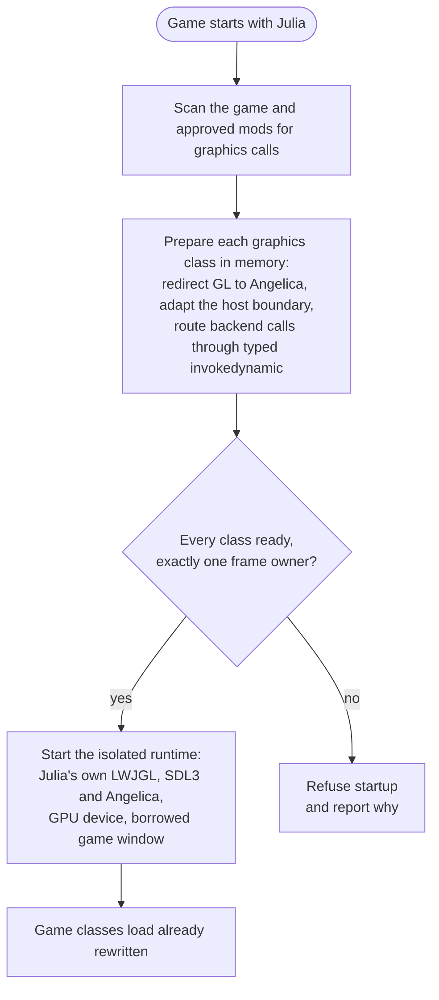
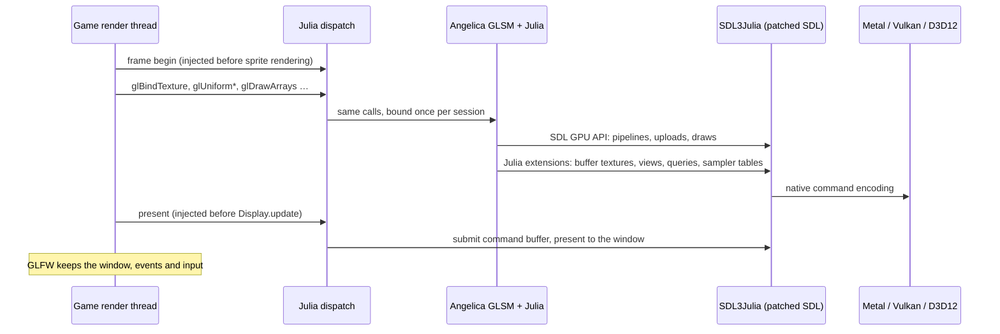

# Architecture

Mods don't need to do anything for Julia: the game and its Java mods keep calling plain OpenGL. Julia redirects those calls in memory as each class loads and draws every frame through
[Angelica](https://github.com/GTNewHorizons/Angelica)'s GL state manager and its SDL3 GPU backend. No OpenGL driver is
involved.

## Startup: all or nothing

Julia has to redirect classes as they first load, so it starts before the game does. ZombieBuddy's preload entry gives it
that slot, and the standalone agent gets it from the JVM. Both then run the same startup, and neither jar carries the
other's entry.

Julia never activates a partial plan. Unsupported calls, ambiguous frame boundaries, or native types crossing the
isolation boundary stop startup before anything is installed. In approved mods, a call Julia cannot translate is
replaced with a fatal diagnostic at that call site, so unused unsupported code does not stop the mod from loading.

Startup loads every prepared class straight away, without initializing it. The JVM hides a class from transformers if it
first loads while another transformer is running on that thread, which ZombieBuddy's patching can trigger, and such a
class would silently keep its native GL calls.

## Every frame

- **Isolation.** The game ships its own LWJGL. Julia's graphics stack lives in a separate class loader and only JDK
  types cross into it, so no game class ever links against Julia's LWJGL.
- **Shaders.** Angelica compiles the game's GLSL to SPIR-V and translates it to the native shading language.
- **Patched SDL.** Julia ships its own SDL 3 build, `SDL3Julia`. Stock SDL GPU lacks some GL features the game and
  mods use, so Julia adds them as native extensions compiled inside SDL's backend for each GPU API. Java calls them
  through bindings in the renderer; the patches live in the Angelica fork, `third_party/angelica/sdl-gpu/native/`.
- **Window.** The game keeps its GLFW window. Julia wraps the native handle (Cocoa, Win32, X11 or Wayland) in an SDL
  window and restores everything it changed when it detaches.
- **Failure.** An exception inside a frame aborts the GPU frame first, so a half-recorded frame is never presented.

What Julia emulates and what it refuses is in [COMPATIBILITY.md](COMPATIBILITY.md#policy).

## Renderer fork

`third_party/angelica/` is [our Angelica fork](https://github.com/fopwoc/Angelica), kept on the `pz` branch over
upstream `master` and pinned to an exact revision. It owns the renderer: GL state, SDL GPU execution, shaders, textures
and the SDL patches. Julia owns the host side: startup, class rewriting, isolation and window borrowing.

Julia builds only the fork's `glsm` and `sdl-gpu` sources, plus a GTNHLib subset from the fork's nested
`third_party/gtnhlib/` submodule, as local Gradle modules. Both are LWJGL3 only, with no Minecraft code, and Julia
never patches them at runtime: renderer changes go into the fork.

Upstream updates are merged into `pz`, never rebased, since Julia pins its commits.

## Layout

| Path | Contents |
| --- | --- |
| `42/`, `common/` | The mod folder: `mod.info`, icons and the main menu status in Lua |
| `java/modules/preload` | ZombieBuddy preload entry and signing |
| `java/modules/agent` | Standalone `-javaagent` entry and startup audit |
| `java/modules/launch` | Startup shared by both entries |
| `java/modules/host` | Isolated class loader and runtime startup |
| `java/modules/transform` | Game and mod bytecode passes; invokes the fork's GL routing |
| `java/modules/backend` | Runtime lifecycle, window borrowing, platform selection and logging |
| `java/modules/render-runtime` | JDK-only types shared across the isolation boundary |
| `java/modules/gl-audit` | Offline scan of game and mod jars for graphics calls |
| `java/modules/utils` | JDK-only helpers shared by every layer |
| `java/modules/glsm`, `sdl-gpu`, `gtnhlib` | Build descriptors that compile the fork's sources |
| `java/modules/workshop` | Packages the Workshop mod |
| `java/tooling/probe` | GPU probes and offline audits |
| `java/tooling/profiling` | OpenGL vs Julia comparison runs ([README](java/tooling/profiling/README.md)) |
| `native/` | Container build for Linux and Windows natives, and the Windows `-agentlib` loader |
| `third_party/angelica/` | The renderer fork |
| `third_party/angelica/renderer-tests/` | Fork-owned renderer CPU regressions |
| `third_party/angelica/sdl-gpu/native/` | SDL patches: `common/` for every API, one folder per GPU API |
| `tools/` | Distribution packaging and dev deploy scripts |
