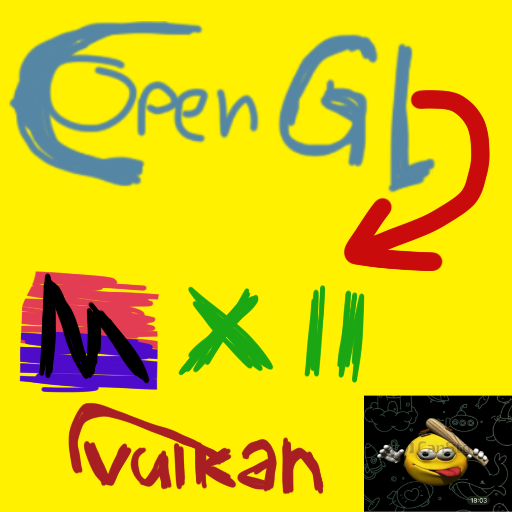
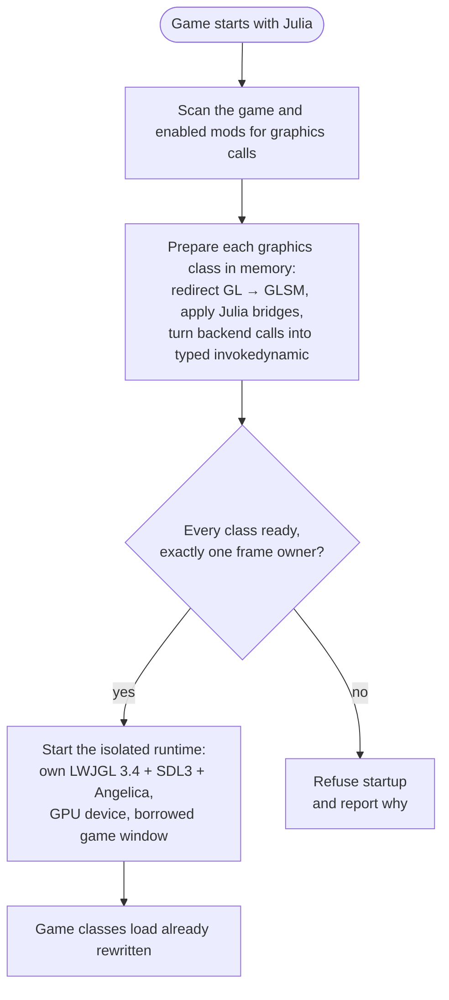
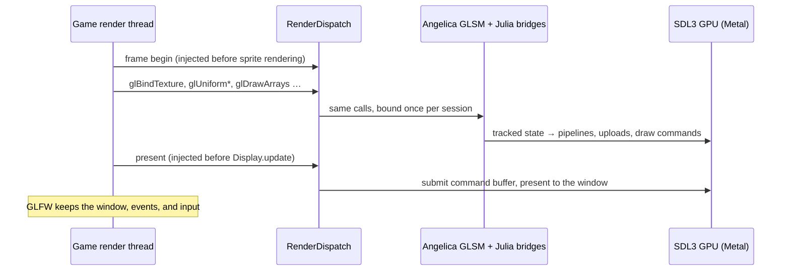

# Julia



Julia is a Project Zomboid (Build 42) client mod that takes the game's OpenGL renderer and runs it on native graphics
APIs. It relies on [Angelica](https://github.com/GTNewHorizons/Angelica)'s GL state manager (GLSM) and its SDL3 GPU
backend.

Game code and mods keep calling plain LWJGL OpenGL. Julia rewrites those calls as classes load, so frames are drawn
with **Metal** on macOS and, later, **Direct3D 12** on Windows and **Vulkan** on Linux. No OpenGL driver is involved.

## How it works

### Startup: all or nothing



Julia never activates a partially supported plan. Unsupported calls, ambiguous frame anchors, or native types crossing
the isolation boundary block startup before live transformations are installed.

### Every frame



- **Isolation.** The game ships its own LWJGL. Julia's graphics stack lives in a separate class loader, and only JDK
  types cross into it. Calls are `invokedynamic` sites bound to the current render session, so no game class ever links
  against Julia's LWJGL.
- **Shaders.** The game's GLSL is compiled by Angelica to SPIR-V and translated to the native shading language.
- **Window.** The game keeps its GLFW window. Julia receives the native handle (Cocoa, Win32, X11 or Wayland), wraps it
  in an SDL window, and puts back the window state it changed when it detaches.
- **Failure.** An exception inside a frame aborts the GPU frame before it propagates, so nothing half-recorded is ever
  presented.

## Status

Julia is experimental and currently targets macOS. Local PZ Build 42 testing has confirmed Metal rendering of menu
videos, map tiles, character previews, world textures, wall cutaways, and the character Info tab. The same dense forest
that previously fell to about 10 FPS now holds 60 FPS in the tester's scene after eliminating repeated index-buffer
readbacks. This is a local result, not a general performance guarantee.

The automated baseline passes 180 JVM tests plus the windowless Metal suite. Checks cover shader linking, uniform
defaults/reflection, streamed indices, texture views, stencil sampling, depth, viewport clipping, video uploads, initial
presentation, ImGui, array resource APIs, multiple draw buffers, native buffer textures, named texture storage/uploads, instanced vertex bindings, and real Metal timer queries. Timer checks verify pending/completed results, elapsed queries,
query reuse, and that CPU sleeps are excluded from measured GPU time. Buffer-texture checks verify 2,560 pixels
plus compute results across R/RG/RGBA 32-bit float, signed, and unsigned formats, with shared updates, ranges,
storage replacement, pending draws, deletion, sampler reflection, and a million-texel view. Instancing checks verify
1,248 pixels across shared bindings, per-vertex and per-instance fetches, full-width unsigned divisors, indexed draws,
pipeline reuse, VAO switching, and legacy attribute rebinding. Named-texture checks verify 377 pixels across 2D,
array and volume storage, mip levels, integer/float/half-float transfers, padded pixel layouts, byte swapping, and
draw/upload ordering while preserving texture-unit bindings. Target-binding checks add 112 pixels and four compute
words for independent 2D/3D/array bindings, save/restore, parameters, mixed samplers, pending clears and deletion.
Named-framebuffer checks add 480 pixels for MRT/read routing, array slices, mips, scissored/masked clears, and
depth-only slice switching and depth-tested drawing for D24 and D32 requests. Native layer-view checks add 208 pixels
for shared 2D/array views, nested mip/layer ranges, uploads, clears, depth-tested writes, and parent deletion.
Program-interface checks add 64 pixels using a reflected uniform location, plus active array sizes, stage usage,
compute image/bool types, output-buffer bounds and relink invalidation. Short-buffer upload checks add 24 exact
16-bit values recovered through shader sampling, covering mutable R16 storage, padded stripes, client-memory bounds
and reuse, independent target bindings, and byte swapping. Graphics-sampler checks add 162 pixels for indirect
resource binding, arrays, filtering, updates and lifetimes. Fence checks add 64 pixels downloaded after real GPU
completion without a device-idle wait, plus finite/unsigned waits, nonblocking polling, deletion before frame swap,
independent live fences, invalid arguments, and flush/finish submission. These checks do not replace in-game validation.

The installed PZ and ZombieBuddy archives prepare together with zero blockers; a separate JVM smoke test initializes
both agents. A Steam launch with both agents reaches the menu and loads a save in local testing. The approval UI's
separate frame-loop adapter and ViewPoint's setup window are visually confirmed. Host update callbacks draw before
Metal presentation, and ImGui uses the logical target size before final Retina scaling. The latest Steam retry
passes ViewPoint named-texture initialization. One retry exposed a shared-target binding query in cloud setup; a later
user run reached `glCreateFramebuffers` in shadow setup. Named framebuffer creation, routing, single-slice attachments
and clears pass offscreen checks. The latest user retry passed that call and reached D24 shadow-array allocation.
Immutable storage now chooses a supported D32 depth representation when D24 is unavailable, preserving the requested
GL internal format and any stencil aspect. The next user retry passed allocation and reached GL43 texture-view creation.
GL43/GL44/ARB texture-view entry points now support same-format 2D/array layer and mip ranges using native Metal
storage views. Shadow-array views, rendering through a view, updates seen from the parent, nested offsets, and storage
lifetime after source deletion pass offscreen checks. The latest user retry passed view setup and reached the program
interface query used for per-stage sampler counts. Scalar/array/buffer interface queries and uniform resource metadata
now use active SPIR-V reflection. The next user retry reached terrain-relief uploads and exposed the missing bound
`ShortBuffer` texture upload. The 2D typed overload now uses the checked client-upload path, and mutable/named R16
allocations keep native 16-bit normalized storage instead of the upstream RGBA8 default. This upload fix passes
windowless checks. The next user run completed loading and reached first-person activation with O, exposing
`GL32.glFenceSync`. GL32/ARB fence creation, client waits, deletion and identity checks now use actual native SDL
submission fences. Each public fence submits preceding work immediately without waiting, which fixes its command
boundary and avoids pending-token resurrection on deletion. Polling does not submit later work. Flush/finish now
submit queued uploads, clears and draws before their completion semantics apply. These changes await an in-game retry.
SDL documents [the platform-dependent D24/D32 support requirement](https://wiki.libsdl.org/SDL3/SDL_GPUTextureFormat).
ViewPoint subsequently exposed 17–20 sampled resources per shader stage, including a 16-element sampler array
beside scalar samplers. Julia now supports up to 32 sampled resources in each graphics stage. Larger layouts and
sampler arrays use Metal tier-2 argument buffers; scalar layouts within the direct 16-slot budget keep the existing
path. Array widths reserve distinct bindings, each element has its own GL uniform location, and integer-array/buffer
uploads preserve caller positions and validate the full assignment before changing it. The native tables, sampler
budget, pending-clear traversal and published graphics limits all use the same 32-slot capacity. Argument tables are
immutable snapshots retained with their sampled textures and sampler objects until GPU completion. Shader cache
names include the new layout identity. The extension is built through CMake; it does not require Python.

Windowless GPU checks verify 162 new pixels across 17/20/32 scalar samplers, mixed filtering, a 16-element sampler
array alongside scalar resources, bulk and partial uploads, queued state changes, sampler overrides, deletion lifetimes,
pending clears above slot 16, and simultaneous 32-vertex/17-fragment sampler stages. The CMake patch is also checked
against pristine SHA-verified SDL 3.4.12 sources and an idempotent second configure. In-game first-person rendering
still needs validation. Compute sampled resources retain their direct 16-slot limit; compute sampler arrays are rejected
explicitly. Graphics layouts exceeding 32 resources are rejected without dropping resources or changing shaders.

Native translation failures after successful desktop GLSL validation throw through Julia's fatal graphics boundary
instead of returning a failed link status that mods can recover from. This covers backend stage translation, native
program linking, linked-stage regeneration and uniform-initializer translation. Invalid source GLSL retains its normal
compiler/linker diagnostics. Windowless probes verify rejection and retained diagnostics for 33 graphics samplers and
unsupported compute sampler arrays; a disposable-process test verifies exit 70 and a durable report even inside a mod's
catch-all exception handler.
The next first-person retry passed shader setup and reached sparse MRT draw-buffer routing in the velocity target.
Julia now preserves leading, interior and trailing `GL_NONE` output slots using absent Metal color attachments and
invalid pipeline formats for those slots. Outputs are not compacted, inactive textures remain untouched, and no dummy
images constrain the render area. Sparse passes retain validation of every real attachment while adapting LWJGL's
non-null struct assumption only at the native boundary. Consecutive draws with leading holes reuse the open pass.
Windowless tests verify 1,248 new pixels across four-output routing, disabled attachments, full target extents, scissor,
selected/masked clears, nonzero array slices, route changes, unsigned fragment outputs and all-disabled color buffers
with working depth rendering. The CMake patch applies to SHA-verified pristine SDL sources and is idempotent. The
sparse-target fix awaits an in-game first-person retry.
ZombieBuddy's standalone native-GL approval executable is outside game preparation and remains rejected if loaded
into the game JVM.

Limits include rejected layered rendering of an entire array/volume, framebuffer-slice readback/blits,
split depth/stencil images, single-aspect rendering of packed depth/stencil images, and SDL depth slice indices above 255.
Bound ShortBuffer and FloatBuffer subimage uploads currently support 2D targets and matching transfer/storage formats.
Logical texture bindings span 128 units, independently of the 32 sampled resources per graphics stage.
High-unit probes cover buffer textures, sampler arrays, sampler overrides, and atomic array assignments.
Metal argument-buffer encoding follows reflected sampler members, including samplerless buffer/2D textures.
Indirect array draws consume GPU-resident command buffers through SDL, including padded command strides.
MSL instance IDs subtract the native base while vertex IDs retain their original meaning; constant attributes
use Metal constant stepping. GPU-compute-generated commands are checked across 240 offscreen pixels.
Indirect client pointers, compatibility primitive modes, and vertex-side-effect replay remain unsupported.
Base-instance array draws offset only instanced attribute bindings after GLSM pointer repair, then restore
the VAO. Shader instance IDs remain zero-based and divisors apply before the base record offset.
Windowless checks cover 960 pixels, including shared bindings, legacy pointers, ordinary draws, and quad conversion.
Core GL43 and inherited GL44/GL45 image-copy entry points, plus ARB copy-image, route directly to the
checked texture-copy implementation. Offscreen checks include copies into a fresh immutable array slice.
Bound `glTexStorage3D` allocations use the same checked immutable allocator as named textures.
Windowless sampling verifies 76 pixels across every tested mip and layer of 3D and 2D-array storage.
Bound IntBuffer subimage uploads support 3D and 2D-array targets with matching transfer/storage formats.
RGB32I/UI client uploads expand to four physical components with integer alpha one, including mutable volume
initialization. Windowless checks verify 864 exact channel values across signed/unsigned volumes and arrays,
including padded image layouts, untouched layers, and byte-swapped partial updates.
Windowless Metal checks verify 84 exact floating-point channel values across R32F, RG32F, and RGBA32F,
including unpack strides/skips, partial updates, byte swapping, and client-buffer reuse.
Named textures are restricted to 2D, 2D arrays and 3D targets, explicitly supported sized storage formats
and matching client transfer formats (plus RGB8/RGB32I/RGB32UI promotion and BGRA8 conversion). Client uploads with pixel-unpack
buffers bound, nonzero named texture base levels and unsupported wrap modes (including clamp-to-border) are rejected.
Other limits include vertex-write compute replay rejecting divisors above 65,535 (ordinary native vertex fetch retains
all 32 unsigned bits), buffer textures restricted to the nine R/RG/RGBA 32-bit formats (no sampler arrays or image load/store),
same-format 2D/array texture views (no format reinterpretation, cube or volume views), a costly stencil-extraction fallback, rejected compute sampling
of stencil views, and rejected linked-stage regeneration with shader storage blocks. Uniform-interface reflection currently covers default-block numeric, sampler and image uniforms; named uniform blocks,
struct uniforms, atomic counters, push constants, separate samplers and multidimensional/runtime uniform arrays are
rejected explicitly. Unplanned or changed graphics
consumers are refused at load time. ZombieBuddy owns mod approval. Julia prepares approved JARs before classpath
publication and patch execution, translating supported graphics operations and replacing unsupported operations with
fatal diagnostics at the call site. Unused unsupported branches do not stop a mod from loading. Unknown integer
and floating-point backend state queries throw instead of returning invented zero limits.
`GL_NUM_PROGRAM_BINARY_FORMATS` explicitly reports zero: Julia does not expose OpenGL program binaries. A user PZ3D
retry reached this previously unhandled capability query; scalar/array/buffer queries and source linking now pass offscreen.
In a live agent session, any translation, backend, frame, or graphics-preparation failure writes and flushes
`fatal-error.txt` in that run's directory, then immediately halts Java with exit code 70. Mod exception handlers,
cleanup, and shutdown hooks cannot continue with a broken renderer. Standalone library tests and offscreen probes
do not arm this live-process policy. Preparation diagnostics are written under `~/Zomboid/julia/run-*/mod-<sha256>.txt`; failures to prepare translation are fatal.
This does not establish ViewPoint rendering support. The Lua-only menu status is user-confirmed in Steam;
ASCII separators avoid missing glyphs.

## Building

The repository root is the mod folder (`common/`, `42/mod.info`). The Gradle build lives in `java/`. You need
JDK 25, and the build works on macOS and Linux only. macOS builds also require CMake 3.24+ and the Xcode
command-line toolchain. The first build downloads a SHA-256-pinned SDL 3.4.12 source archive and builds Julia's
Metal timestamp, buffer-texture, vertex-input and texture-view extensions; later builds reuse the native build directory. Linux retains the upstream SDL binary;
its native timer provider and game-window integration are not implemented yet.

```sh
cd java
./gradlew check                    # tests; never launches the game or opens a window
./gradlew :agent:jar               # → modules/agent/build/libs/julia-agent.jar
./gradlew :zomboid-mod:modZip      # → modules/zomboid-mod/build/distributions/Julia.zip (Lua status companion)
```

The repository folder is the Lua status companion. Copy it into the PZ `mods` directory as `Julia`, or extract the ZIP.
The agent is installed separately; building never modifies the live game.

These native probes run only when requested and open no window:

```sh
./gradlew :probe:renderProbe       # raw Metal device: clear + translated textured draw
./gradlew :probe:adapterProbe      # full GLSM adapter on redirected OpenGL calls
./gradlew :probe:suiteProbe        # both, in the same order as the mod
./gradlew :probe:installDist       # standalone probe CLI; does not install the mod
JAVA_OPTS="-XstartOnFirstThread --enable-native-access=ALL-UNNAMED" \
  modules/probe/build/install/probe/bin/probe --imgui-adapter /tmp/imgui-probe /path/to/game.jar /path/to/natives
```

These offline audits read JAR bytecode and never load game classes:

```sh
./gradlew :probe:installDist
modules/probe/build/install/probe/bin/probe --prepare-runtime preparation.tsv projectzomboid.jar
modules/probe/build/install/probe/bin/probe --audit-redirects --compat redirects.tsv projectzomboid.jar
```

Logging defaults to `error`. Set `LOG_LEVEL=warn|info|debug` to see more.

## In the game

Copy the built `java/modules/agent/build/libs/julia-agent.jar` into the game's Java directory.
On macOS this is `Project Zomboid.app/Contents/Java`. With ZombieBuddy installed, use these Steam launch options:

```text
-XstartOnFirstThread -javaagent:julia-agent.jar=activate -javaagent:ZombieBuddy.jar --
```

ZombieBuddy is optional: omit its `-javaagent` option when it is not installed. When using both agents, Julia must
register first. Keep the final `--`, required by the macOS
launcher. Julia activates before the in-game mod list is available: disabling its mod-list entry does not disable the
agent. Remove its `-javaagent` option to return to vanilla rendering. ZombieBuddy approvals remain in force.

The optional Lua-only Julia mod shows live renderer status at the bottom left of the main menu, such as
`Julia active | Metal`, or `Julia inactive` when the renderer is absent. It requires no ZombieBuddy approval or Java JAR.
Enable this companion in the mod manager to show it. It does not activate the agent itself.

`activate` creates a fresh directory under `~/Zomboid/julia/run-*/` on every launch. For a controlled test,
`activate=/absolute/path/new-run` selects an explicit fresh report directory. Logs default to `error`; `LOG_LEVEL`
enables more detail. Keep test saves separate until the desired mod combination has been validated.

Diagnostic Java entry points remain in the development modules; they are not included in the Lua companion ZIP.

## License

Julia's own code is [WTFNMFPL](LICENSE). The bundled Angelica, LWJGL3ify, and RetroFuturaBootstrap libraries are LGPL v3.
See [THIRD_PARTY.md](THIRD_PARTY.md).

> [!NOTE]
> This project contains AI-generated code. See [AI_USAGE.md](AI_USAGE.md) for details.

### Controlled startup tests

Use `-javaagent:/absolute/path/julia-agent.jar=activate=/absolute/path/new-report-directory` with a separate game
profile. Unsupported in-process consumers block startup; activation does not automatically fall back to vanilla.

Sampler binding validation excludes inactive uniforms retained only by unreachable shader helpers. Those declarations
keep their normal `-1` uniform locations and do not request buffer-texture storage or conflict with active samplers
at default unit zero. Windowless checks cover unused cube, buffer and array samplers in both direct and argument-buffer
layouts, while conflicting active sampler targets still fail with the unit, sampler name and target details.
