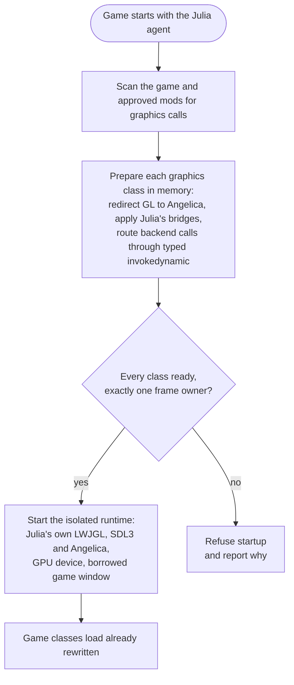
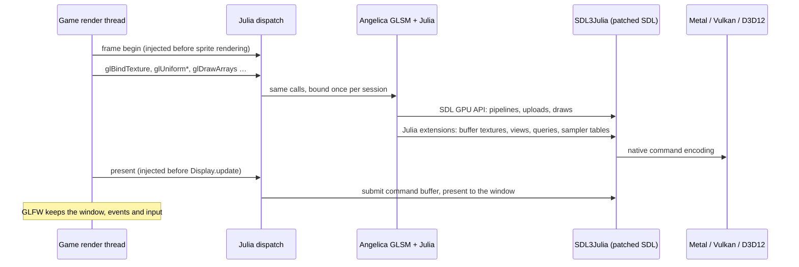

# Julia


Julia does one thing: it translates Project Zomboid's OpenGL rendering to the platform's native graphics API —
**Metal** on macOS today, with **Vulkan** on Linux and **Direct3D 12** on Windows planned. Modern APIs carry less driver
overhead than OpenGL, which can mean higher and steadier FPS.

The translation is seamless. Nothing is ported, and no mod needs a Julia-specific version or patch: the game and its
Java mods ship exactly as they are and keep calling plain OpenGL. Julia redirects those calls in memory as each class
loads and draws every frame through [Angelica](https://github.com/GTNewHorizons/Angelica)'s GL state manager and its
SDL3 GPU backend. Files on disk are never changed, and no OpenGL driver is involved.

A side effect on macOS: Apple's OpenGL is deprecated and stops at version 4.1, so mods that need newer GL features
cannot run there. Because Julia never touches Apple's OpenGL, those mods work on Mac too. [ViewPoint](https://steamcommunity.com/sharedfiles/filedetails/?id=3809306528), which needs
GL 4.3, is the first example.

Julia targets **Project Zomboid Build 42** and is **experimental**.

> [!NOTE]
> This project contains AI-generated code. See [AI_USAGE.md](AI_USAGE.md) for details.

## Support

Status legend: ✅ works · 🧪 built but untested · 🚧 planned · ➖ not applicable

### Platforms

| OS | CPU | GPU API | Status |
| --- | --- | --- | --- |
| macOS | Apple silicon (arm64) | Metal | ✅ |
| macOS | Intel (x64) | Metal | 🧪 |
| Linux | x64 | Vulkan | 🚧 |
| Windows | x64 | Direct3D 12 | 🚧 |

One `julia-agent.jar` carries the natives for every platform above and picks the right ones at startup. On a planned
platform it stops with a clear "not ported" error instead of rendering.

### GL features by GPU API

Angelica translates core rendering for every API. Julia adds the GL features below through its own native SDL
extensions, implemented per API.

| Feature | Metal | Vulkan | Direct3D 12 |
| --- | --- | --- | --- |
| Core rendering: state, shaders, textures, framebuffers, draws | ✅ | 🚧 | 🚧 |
| Buffer textures (`samplerBuffer`), including empty stores | ✅ | 🚧 | 🚧 |
| Texture views (`glTextureView`, 2D and array) | ✅ | 🚧 | 🚧 |
| Up to 32 sampled resources per graphics stage | ✅ | 🚧 | 🚧 |
| Sparse draw buffers (`GL_NONE` color slots) | ✅ | 🚧 | 🚧 |
| Full-width instance divisors and base instances | ✅ | 🚧 | 🚧 |
| Timer queries (`GL_TIME_ELAPSED`, `GL_TIMESTAMP`) | ✅ | 🚧 | 🚧 |
| Occlusion queries (`GL_SAMPLES_PASSED`, `GL_ANY_SAMPLES_PASSED`) | ✅ | 🚧 | 🚧 |
| Fences (`glFenceSync`, `glClientWaitSync`) | ✅ | 🚧 | 🚧 |

### Game and mods

| | Status | Notes |
| --- | --- | --- |
| Vanilla Build 42 | ✅ | Menu, loading, world, map, character previews |
| [ZombieBuddy](https://github.com/zed-0xff/ZombieBuddy) | ✅ | Optional; Julia translates the Java mods it approves |
| [ViewPoint](https://steamcommunity.com/sharedfiles/filedetails/?id=3809306528) | ✅ | All presets run; high and extreme still show visual bugs |

### Known limits

These GL features stop the game with a report rather than rendering incorrectly:

- Rendering to a whole array or 3D texture at once, and reading back or blitting framebuffers that target one slice.
- Texture views that change format, or views of cube and 3D textures.
- Buffer textures in formats other than R/RG/RGBA 32-bit and RGBA16UI, and image load/store on buffer textures.
- More than 32 sampled resources in one graphics stage, or more than 16 in a compute shader.
- Uniform blocks, struct uniforms and atomic counters in uniform queries.
- Indirect draws from client memory pointers.

## Install

Julia is a Java agent that starts with the game. It never patches game files on disk.

1. Download `julia-<version>-agent.jar` from the [releases](../../releases) page and save it as `julia-agent.jar`.
2. Copy it into the game's Java directory:

   | OS | Directory |
   | --- | --- |
   | macOS | `Project Zomboid.app/Contents/Java` |
   | Linux | the game directory that contains `projectzomboid.jar` (🚧) |
   | Windows | the game directory that contains `projectzomboid.jar` (🚧) |

3. Add Steam launch options:

   | OS | Launch options |
   | --- | --- |
   | macOS | `-XstartOnFirstThread -javaagent:julia-agent.jar=activate --` |
   | Linux / Windows | `-javaagent:julia-agent.jar=activate --` (🚧) |

   With ZombieBuddy, add its agent **after** Julia's, for example
   `-XstartOnFirstThread -javaagent:julia-agent.jar=activate -javaagent:ZombieBuddy.jar --`. Keep the final `--`.

4. Optional: enable the **Julia** Lua mod from the Workshop or `Julia.zip`. It only shows `Julia active | Metal` or
   `Julia inactive` in the corner of the main menu; it does not turn Julia on or off.

Remove the `-javaagent:julia-agent.jar=activate` option to return to vanilla rendering. Disabling the Lua mod does not
disable the agent.

## Troubleshooting

Every launch writes a fresh report directory under `~/Zomboid/julia/run-*/`:

| File | Contents |
| --- | --- |
| `renderer.txt` | Backend, frame count, and whether rendering is active |
| `preparation.txt` | How many game classes were translated and any blockers |
| `mod-<sha256>.txt` | Per-mod translation report, including calls Julia cannot translate |
| `fatal-error.txt` | The failure that stopped the game, with its stack trace |

Julia is fail-fast: if it cannot translate or render something correctly, it writes `fatal-error.txt` and stops the
game with exit code 70 instead of drawing a wrong frame. Mods cannot catch and hide that failure. When reporting a
problem, include the newest `fatal-error.txt`.

For more detail, set `LOG_LEVEL=warn`, `info` or `debug` (default `error`). To choose the report directory yourself,
use `activate=/absolute/path/new-run` instead of `activate`.

## How it works

### Startup: all or nothing



Julia never activates a partial plan. Unsupported calls, ambiguous frame boundaries, or native types crossing the
isolation boundary stop startup before anything is installed. In approved mods, a call Julia cannot translate is
replaced with a fatal diagnostic at that call site, so unused unsupported code does not stop the mod from loading.

### Every frame



- **Isolation.** The game ships its own LWJGL. Julia's graphics stack lives in a separate class loader and only JDK
  types cross into it, so no game class ever links against Julia's LWJGL.
- **Shaders.** Angelica compiles the game's GLSL to SPIR-V and translates it to the native shading language.
- **Patched SDL.** Julia ships its own SDL 3 build, `SDL3Julia`. Stock SDL GPU lacks some GL features the game and
  mods use, so Julia adds them as native extensions compiled inside SDL's backend for each GPU API. Java calls them
  through `backend.sdl`; the patches live in `native/sdl/`.
- **Window.** The game keeps its GLFW window. Julia wraps the native handle (Cocoa, Win32, X11 or Wayland) in an SDL
  window and restores everything it changed when it detaches.
- **Failure.** An exception inside a frame aborts the GPU frame first, so a half-recorded frame is never presented.

### Compatibility policy

Julia follows the OpenGL specification and fails fast on anything it cannot reproduce exactly. One exception: when
code relies on a pattern that the specification forbids but every desktop driver accepts with one obvious meaning,
Julia emulates that meaning and logs a warning once. For example:

- Samplers of different types left on the same texture unit, behind branches that never read them. Each sampler reads
  its own target's binding on that unit, as desktop drivers do.
- An integer vertex input whose attribute array is disabled. Julia declares the matching integer format instead of
  float.
- A buffer texture attached to an empty buffer. It has width zero and reads as zero, as GL defines.

Anything ambiguous still stops the game with a report.

## Building

The repository root is the Lua mod folder (`common/`, `42/`); the Gradle build lives in `java/`.

Requirements: JDK 25 and CMake 3.24+. On macOS, also the Xcode command-line tools. The first build downloads a
SHA-256-pinned SDL 3.4.12 archive, patches a copy, and builds `SDL3Julia` for the host; later builds are incremental.

```sh
cd java
./gradlew check            # unit tests; never launches the game or opens a window
./gradlew :agent:jar       # → modules/agent/build/libs/julia-agent.jar
./gradlew :workshop:modZip # → modules/workshop/build/distributions/Julia.zip (Lua companion)
```

The agent jar bundles LWJGL natives for every platform in the support table and Julia's SDL build for the host. To
include SDL builds made on other hosts, pass `-PjuliaNatives=<dir>`, where `<dir>` holds `<os>/<arch>/<library>`,
for example `linux/x64/libSDL3Julia.so` or `windows/x64/SDL3Julia.dll`.

### GPU probes

Windowless GPU checks run only on request. They create a real device but open no window:

```sh
./gradlew :probe:suiteProbe   # raw device baseline, then the full translated GL feature suite
./gradlew :probe:renderProbe  # raw device: clear and one translated textured draw
./gradlew :probe:adapterProbe # the full suite without the raw baseline
```

Reports land in `modules/probe/build/reports/`. Run `suiteProbe` after any change to class loading, bytecode patches or
native extensions; unit tests cannot cover those paths.

### Offline audits

These read JAR bytecode and never load game classes:

```sh
./gradlew :probe:installDist
modules/probe/build/install/probe/bin/probe --prepare-runtime preparation.tsv projectzomboid.jar
modules/probe/build/install/probe/bin/probe --audit-redirects --compat redirects.tsv projectzomboid.jar
```

### Layout

| Path | Contents |
| --- | --- |
| `java/modules/agent` | The `-javaagent` entry point and startup audit |
| `java/modules/host` | Isolated class loader and live runtime startup |
| `java/modules/transform` | Bytecode passes for game and mod code, and pinned patches to Angelica |
| `java/modules/backend` | Julia's GL backend over Angelica: GL layers, subsystems, OS and GPU-API seams |
| `java/modules/render-runtime` | JDK-only types shared across the isolation boundary |
| `java/modules/probe` | GPU probes and offline audit CLI |
| `java/modules/workshop` | Packages the Lua companion mod |
| `native/sdl` | SDL patches: `common/` for every API, one folder per GPU API (`metal/` today) |

### Flags

| Flag | Where | Effect |
| --- | --- | --- |
| `-javaagent:julia-agent.jar=activate` | Launch options | Render through Julia; reports go to a fresh `~/Zomboid/julia/run-*/` |
| `-javaagent:julia-agent.jar=activate=<dir>` | Launch options | Same, with reports in `<dir>` |
| `-javaagent:julia-agent.jar=<report.tsv>` | Launch options | Audit only: record which classes make graphics calls into a new file; rendering is unchanged |
| `-Djulia.drawTrace=true` | Launch options or probe JVM | Bounded CPU draw-state snapshots and compiler inputs beside renderer/probe reports; no GPU readbacks |
| `-Djulia.metalHud=true` | Launch options, macOS | Show Apple's Metal Performance HUD over the game |
| `LOG_LEVEL=debug\|info\|warn\|error` | Environment | Julia's log detail on stderr; default `error` |
| `-PjuliaNatives=<dir>` | Gradle | Pack other hosts' SDL builds (`<os>/<arch>/<library>`) into the agent jar |
| `-Djulia.probe.width=<px>`, `-Djulia.probe.height=<px>` | Probe JVM | Offscreen size of the adapter probe; default 32 × 32 |

With draw tracing enabled, create `draw-trace.request` inside the current run directory to restart capture at the next
frame boundary. This replaces `draw-trace.txt` and resets its snapshot quota, so a stable in-game defect can be captured
after startup. Matching vertex and fragment compiler inputs are stored in `draw-shaders/` (at most 8 MiB per capture).

## License

Julia's own code is [WTFNMFPL](LICENSE). Bundled Angelica, LWJGL3ify and RetroFuturaBootstrap are LGPL v3; see
[THIRD_PARTY.md](THIRD_PARTY.md).
