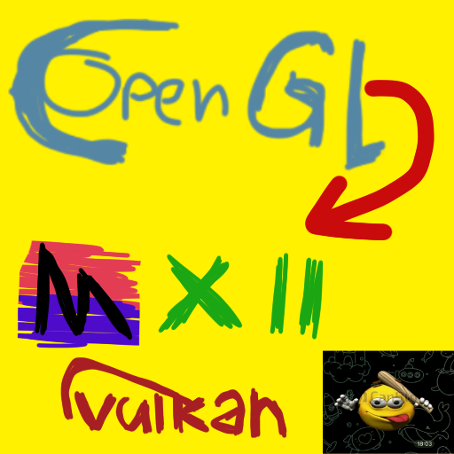

# Julia

[](https://github.com/fopwoc/julia-pz/actions/workflows/ci.yml)
[](https://steamcommunity.com/sharedfiles/filedetails/?id=3825737766)



Julia translates Project Zomboid's OpenGL rendering to the platform's native graphics API: **Metal** on macOS and
**Vulkan** on Linux and Windows. It runs as a [ZombieBuddy](https://steamcommunity.com/sharedfiles/filedetails/?id=3619862853)
mod that starts with the game. The game and its mods run unchanged, nothing on disk or in saves is modified, and Julia
can be added or removed at any time.

Julia targets **Project Zomboid Build 42** and is **experimental**. It doesn't cover the whole OpenGL specification
yet, so some mods may stop with a report. Multiplayer is untested, but Julia doesn't touch gameplay, so it should be safe there too. Bug reports and contributions are welcome.

> [!NOTE]
> This project contains AI-generated code. See [AI_USAGE.md](AI_USAGE.md) for details.

## Why

- **Performance.** Modern APIs carry less driver overhead than OpenGL, which can mean higher and steadier FPS. Results
  depend on the machine: on an M4 Max Mac Julia is faster in every real scene, while on an NVIDIA PC it trails in dense
  ones. See [BENCHMARKS.md](BENCHMARKS.md).
- **Compatibility.** Apple's OpenGL is deprecated and stops at version 4.1, so mods that need newer GL features cannot
  run on macOS. Julia never touches Apple's OpenGL, so those mods work on Mac too.
  [Viewpoint](https://steamcommunity.com/sharedfiles/filedetails/?id=3809306528), which needs GL 4.3, is the first
  example.

## Support

| Project Zomboid | Status |
| --- | --- |
| 42.21 | ✅ |
| 42.22 | ✅ |
| Other Build 42 releases | Untested |

Julia runs on macOS (Metal), Linux and Windows (Vulkan). Supported platforms, tested mods with their versions, and GL
features are in [COMPATIBILITY.md](COMPATIBILITY.md).

## Install

Julia runs as a [ZombieBuddy](https://steamcommunity.com/sharedfiles/filedetails/?id=3619862853) preload mod and never
patches game files on disk.

1. Install ZombieBuddy by following its Workshop page.
2. Subscribe to the [Julia Workshop item](https://steamcommunity.com/sharedfiles/filedetails/?id=3825737766) and
   enable it.
3. Start the game, approve Julia in ZombieBuddy's dialog, and restart. That first launch runs without Julia; later ones
   start it during ZombieBuddy's startup, before anything draws.

The corner of the main menu shows Julia's state, such as `Julia 0.0.3 active | Metal`, or what it still needs. To return
to vanilla rendering, disable the mod.

To check the mod's jar was built by this repository's release workflow, run this on it with the
[GitHub CLI](https://cli.github.com):

```sh
gh attestation verify julia-preload.jar --repo fopwoc/julia-pz
```

### Standalone agent

Julia also runs as a Java agent without ZombieBuddy. It ships only on the
[releases page](https://github.com/fopwoc/julia-pz/releases), not with the Workshop item.

Download `julia-<version>-agent.jar` and save it as `julia-agent.jar`. On Windows, also download
`julia-<version>-windows-loader.dll` and save it as `julia.dll`.

0. Optional: check that the files were built by this repository's release workflow, with the
   [GitHub CLI](https://cli.github.com):

   ```sh
   gh attestation verify julia-agent.jar --repo fopwoc/julia-pz
   gh attestation verify julia.dll --repo fopwoc/julia-pz
   ```

1. Copy `julia-agent.jar` (and on Windows `julia.dll`) into the game's Java directory:

   | OS | Directory |
   | --- | --- |
   | macOS | `Project Zomboid.app/Contents/Java` |
   | Linux, Windows | the folder that contains `projectzomboid.jar` |

2. Add Steam launch options. The final `--` must stay.

   | OS | Launch options |
   | --- | --- |
   | macOS | `-javaagent:julia-agent.jar=activate --` |
   | Linux | `%command% -javaagent:julia-agent.jar=activate --` |
   | Windows | `-agentlib:julia=activate --` |

   With ZombieBuddy's own agent, put it **after** Julia's:

   | OS | Launch options |
   | --- | --- |
   | macOS | `-javaagent:julia-agent.jar=activate -javaagent:ZombieBuddy.jar --` |
   | Linux | `%command% -javaagent:julia-agent.jar=activate -javaagent:ZombieBuddy.jar --` |
   | Windows | `-agentlib:julia=activate -agentlib:zbNative --` |

   Use Steam launch options, not the ZombieBuddy installer's `ProjectZomboid64.json` option, which loads ZombieBuddy
   before Julia.

PZ's Windows launcher cannot start a `-javaagent` jar by itself, so `julia.dll` starts it, the way ZombieBuddy's
`zbNative.dll` does. To return to vanilla rendering, remove the launch options and delete the jar (and `julia.dll`).

## Troubleshooting

Every launch writes a fresh report directory under `Zomboid/julia/run-*/` in your home folder: `~/Zomboid` on macOS
and Linux, `%UserProfile%\Zomboid` on Windows. Under Proton it is inside the game's prefix,
`steamapps/compatdata/108600/pfx/drive_c/users/steamuser/Zomboid`.

| File | Contents |
| --- | --- |
| `renderer.txt` | Backend, frame count, and whether rendering is active |
| `preparation.txt` | How many game classes were translated and any blockers |
| `mod-<sha256>.txt` | Per-mod translation report, including calls Julia cannot translate |
| `fatal-error.txt` | The failure that stopped the game, with its stack trace |

The main menu corner shows Julia's state and what it still needs. If it reports a failure, or stays on `Julia is waiting`:

- A failure to start is written to `Zomboid/julia/preload-error.txt`.
- ZombieBuddy checks Julia's signature against a key on its author's Steam profile. If Steam can't answer, its log says
  `ZBS verification invalid` with `Could not load Steam profile`. That doesn't mean the mod is damaged: restart and it
  checks again.
- On macOS, every jar in the game's Java directory is on the class path. Delete any old `julia-agent.jar` from there
  unless you are using the standalone agent.

Julia is fail-fast: if it cannot translate or render something correctly, it writes `fatal-error.txt` and stops the
game with exit code 70 instead of drawing a wrong frame. Mods cannot catch and hide that failure. When reporting a
problem, include the newest `fatal-error.txt`.

For more detail, set `LOG_LEVEL=warn`, `info` or `debug` (default `error`). On Linux and Proton, put it in front of
Steam's `%command%`, for example `LOG_LEVEL=info %command%`.

## FAQ

**Is Julia a ZombieBuddy mod?** Yes: the Workshop item is a signed ZombieBuddy preload mod. A standalone agent for launches without ZombieBuddy is on the releases page.

**Why does the first launch not use Julia?** ZombieBuddy shows its approval dialog on that launch, and Julia only starts
on the launch after approval. The menu tells you when a restart is needed.

**Will Julia raise my FPS?** Maybe. On some machines it clearly does, on others it is slower; see
[BENCHMARKS.md](BENCHMARKS.md).

**The game stops when I use mod X.** That is on purpose: Julia stops when it hits something it cannot render
correctly. Open an issue with the newest `fatal-error.txt`; usually it is a GL feature Julia does not
cover yet.

## More

- [COMPATIBILITY.md](COMPATIBILITY.md): platforms, tested mods, GL features and known limits
- [BENCHMARKS.md](BENCHMARKS.md): OpenGL vs Julia frame rates
- [ARCHITECTURE.md](ARCHITECTURE.md): how Julia works and where things live
- [DEVELOPMENT.md](DEVELOPMENT.md): building, probes, audits and debug flags

## License

Julia's own code is [WTFNMFPL](LICENSE). Bundled Angelica and GTNHLib are LGPL v3; see
[THIRD_PARTY.md](THIRD_PARTY.md).
