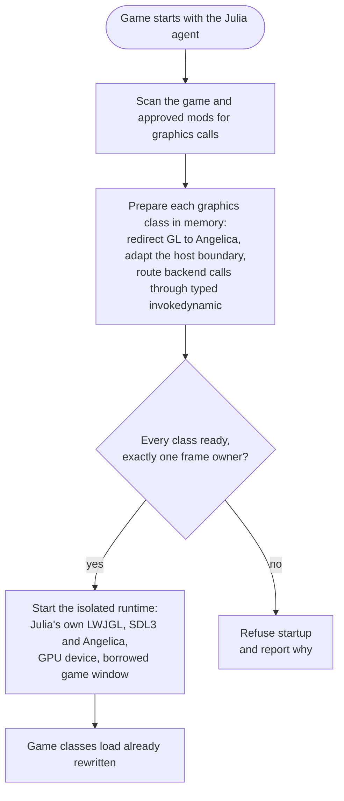
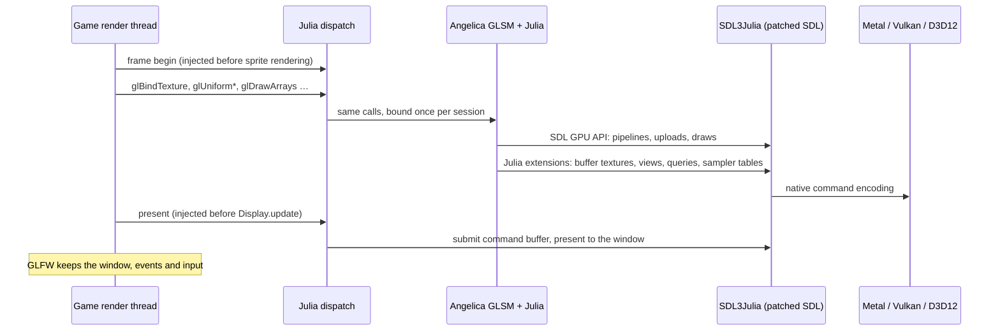

# Julia

[](https://github.com/fopwoc/julia-pz/actions/workflows/ci.yml)
[](https://steamcommunity.com/sharedfiles/filedetails/?id=3825737766)


Julia translates Project Zomboid's OpenGL rendering to the platform's native graphics API: **Metal** on macOS and
**Vulkan** on Linux and Windows. It is a Java agent that starts with the game. The game and its mods run unchanged,
nothing on disk or in saves is modified, and Julia can be added or removed at any time.

Julia targets **Project Zomboid Build 42** and is **experimental**. It doesn't cover the whole OpenGL specification
yet, so some mods may stop with a report. Multiplayer is untested. Bug reports and contributions are welcome.

> [!NOTE]
> This project contains AI-generated code. See [AI_USAGE.md](AI_USAGE.md) for details.

## Why

- **Performance.** Modern APIs carry less driver overhead than OpenGL, which can mean higher and steadier FPS. Julia
  has not been benchmarked widely yet, and results range from a real gain to slower frames.
- **Compatibility.** Apple's OpenGL is deprecated and stops at version 4.1, so mods that need newer GL features cannot
  run on macOS. Julia never touches Apple's OpenGL, so those mods work on Mac too.
  [ViewPoint](https://steamcommunity.com/sharedfiles/filedetails/?id=3809306528), which needs GL 4.3, is the first
  example.

## Support

Status legend: ✅ works · 🧪 experimental, gameplay testing pending · 🚧 planned

### Platforms

| OS | CPU | GPU API | Status |
| --- | --- | --- | --- |
| macOS | Apple silicon (arm64) | Metal | ✅ |
| macOS | Intel (x64) | Metal | 🧪 |
| Linux | x64 | Vulkan | ✅ |
| Windows | x64 | Vulkan | ✅ |

The universal Julia jars carry the natives for every platform above and picks the right ones at startup.
Linux follows the game's GLFW backend. PZ uses X11 by default (XWayland on Wayland desktops), and that path is tested on a
Steam Deck (RADV) and an RTX 4060 Ti PC (NVIDIA driver). Native Wayland is opt-in through `-Dzomboid.wayland=1` and
probably works in windowed mode, but fractional scaling misplaces clicks in ZombieBuddy's overlay, and fullscreen leaves
the game without a visible window. Windows is tested with Proton, not on native Windows; reports from real Windows
machines are very welcome.

### GL features by GPU API

Angelica translates core rendering for every API. Julia adds the GL features below through its own native SDL
extensions, implemented per API.

| Feature | Metal | Vulkan | Direct3D 12 |
| --- | --- | --- | --- |
| Core rendering: state, shaders, textures, framebuffers, draws | ✅ | ✅ | 🚧 |
| Buffer textures (`samplerBuffer`), including empty stores | ✅ | ✅ | 🚧 |
| Texture views (`glTextureView`, 2D and array) | ✅ | ✅ | 🚧 |
| Up to 32 sampled resources per graphics stage | ✅ | ✅ | 🚧 |
| Sparse draw buffers (`GL_NONE` color slots) | ✅ | ✅ | 🚧 |
| Full-width instance divisors and base instances | ✅ | ✅ | 🚧 |
| Timer queries (`GL_TIME_ELAPSED`, `GL_TIMESTAMP`) | ✅ | ✅ | 🚧 |
| Occlusion queries (`GL_SAMPLES_PASSED`, `GL_ANY_SAMPLES_PASSED`) | ✅ | ✅ | 🚧 |
| Fences (`glFenceSync`, `glClientWaitSync`) | ✅ | ✅ | 🚧 |

### Compatibility list

| Mod | Status | Notes |
| --- | --- | --- |
| [ViewPoint](https://steamcommunity.com/sharedfiles/filedetails/?id=3809306528) | Works | All presets run, including high and extreme, some minor far LODs rendering issues |
| [Grassier Grass](https://steamcommunity.com/sharedfiles/filedetails/?id=3818853354) | Works | Probably all good |
| [WinterFX](https://steamcommunity.com/sharedfiles/filedetails/?id=3819972196) | Works | it uses the mesh path because tessellation isn't supported |
| Visceral | Works | |
| [PZ3D](https://steamcommunity.com/sharedfiles/filedetails/?id=3807334881) | Broken | Reaches world load, then needs geometry shaders (cube shadows, rain, lightning, fog), which SDL GPU lacks |

### Known limits

These GL features stop the game with a report rather than rendering incorrectly:

- Rendering to a whole array or 3D texture at once, and reading back or blitting framebuffers that target one slice.
- Texture views that change format, or views of cube and 3D textures.
- Buffer textures in formats other than R/RG/RGBA 32-bit, R16I/R16UI and RGBA16UI, and image load/store on buffer
  textures.
- More than 32 sampled resources in one graphics stage, or more than 16 in a compute shader.
- Uniform blocks, struct uniforms and atomic counters in uniform queries.
- Indirect draws from client memory pointers.
- Tessellation shaders and 1D textures. Tessellation stages fail to compile, as on hardware without them, so mods
  that check fall back.
- Integer colour clears to non-zero values, and shader storage ranges that start past offset 0.

SDL GPU has no border colour, so `GL_CLAMP_TO_BORDER` and legacy `GL_CLAMP` clamp to the edge texel instead. This is
the one approximation; Julia logs a warning the first time it happens.

Geometry shaders are not supported yet and are not caught early either: SDL GPU has no geometry stage and Angelica
links such programs without it. On Metal the first draw then fails pipeline creation; on Vulkan it may draw incorrectly.

## Install

Julia runs as a [ZombieBuddy](https://steamcommunity.com/sharedfiles/filedetails/?id=3619862853) preload mod and never
patches game files on disk. The Workshop item is this way of using Julia.

1. Install ZombieBuddy.
2. Subscribe to the Julia Workshop item and enable it.
3. Start the game, approve Julia in ZombieBuddy's dialog, and restart. That first launch runs without Julia; later ones
   start it during ZombieBuddy's startup, before anything draws.

The corner of the main menu shows Julia's state, such as `Julia 1.2.3 active | Metal`, or what it still needs. To return
to vanilla rendering, disable the mod.

### Standalone agent

For launches without ZombieBuddy, the releases page has a separate agent. Nothing else in this section applies to the
Workshop item, and the agent jar does not come with it.

Download `julia-<version>-agent.jar` and save it as `julia-agent.jar`. On Windows, also download
`julia-<version>-windows-loader.dll` and save it as `julia.dll`.

0. Optional: make sure the binaries are genuine, built by this repository's release workflow. Check them with the
   [GitHub CLI](https://cli.github.com):

   ```sh
   gh attestation verify julia-agent.jar --repo fopwoc/julia-pz
   gh attestation verify julia.dll --repo fopwoc/julia-pz
   ```

1. Copy `julia-agent.jar` (and on Windows `julia.dll`) into the game's Java directory:

   | OS | Directory |
   | --- | --- |
   | macOS | `Project Zomboid.app/Contents/Java` |
   | Linux | the game directory that contains `projectzomboid.jar` |
   | Windows | the game directory that contains `projectzomboid.jar` |

2. Add Steam launch options:

   | OS | Launch options |
   | --- | --- |
   | macOS | `-XstartOnFirstThread -javaagent:julia-agent.jar=activate --` |
   | Linux | `%command% -javaagent:julia-agent.jar=activate --` |
   | Windows | `-agentlib:julia=activate --` |

   The final `--` must stay.

   PZ's Windows launcher cannot start a `-javaagent` jar: the JVM's `instrument.dll` does not find its own libraries
   from the game directory. `julia.dll` loads it from `jre64\bin` and starts `julia-agent.jar` with the same options,
   the way ZombieBuddy's `zbNative.dll` does.

To return to vanilla rendering, remove Julia's launch option; you can also delete the jar (and `julia.dll`).

## Troubleshooting

Every launch writes a fresh report directory under `Zomboid/julia/run-*/` in your home folder: `~/Zomboid` on macOS
and Linux, `%UserProfile%\Zomboid` on Windows. Under Proton it is inside the game's prefix,
`steamapps/compatdata/108600/pfx/drive_c/users/steamuser/Zomboid`.

| File | Contents |
| --- | --- |
| `renderer.txt` | Backend, frame count, and whether rendering is active |
| `preparation.txt` | How many game classes were translated and any blockers |
| `mod-<sha256>.txt` | Per-mod translation report, including calls Julia cannot translate |
| `fatal-error.txt` | The failure that stopped the game, with its stack trace |

Julia is fail-fast: if it cannot translate or render something correctly, it writes `fatal-error.txt` and stops the
game with exit code 70 instead of drawing a wrong frame. Mods cannot catch and hide that failure. When reporting a
problem, include the newest `fatal-error.txt`.

For more detail, set `LOG_LEVEL=warn`, `info` or `debug` (default `error`). On Linux and Proton, put it in front of
Steam's `%command%`, for example `LOG_LEVEL=info %command%`. With the standalone agent, `activate=/absolute/path/new-run`
in place of `activate` chooses the report directory.

## FAQ

**Is Julia a ZombieBuddy mod?** Yes: the Workshop item is a signed ZombieBuddy preload mod. A standalone agent for launches without ZombieBuddy is on the releases page.

**Will Julia raise my FPS?** Maybe. It is experimental: results so far range from a real gain to slower frames or a
stopped game.

**The game stops when I use mod X.** That is on purpose: Julia stops when it hits something it cannot render
correctly. Open an issue with the newest `fatal-error.txt`; usually it is a GL feature Julia does not
cover yet.

## How it works

Nothing is ported, and no mod needs a Julia-specific version or patch: the game and its Java mods keep calling plain
OpenGL. Julia redirects those calls in memory as each class loads and draws every frame through
[Angelica](https://github.com/GTNewHorizons/Angelica)'s GL state manager and its SDL3 GPU backend. No OpenGL driver is
involved.

### Startup: all or nothing



Julia never activates a partial plan. Unsupported calls, ambiguous frame boundaries, or native types crossing the
isolation boundary stop startup before anything is installed. In approved mods, a call Julia cannot translate is
replaced with a fatal diagnostic at that call site, so unused unsupported code does not stop the mod from loading.

### Every frame



- **Isolation.** The game ships its own LWJGL. Julia's graphics stack lives in a separate class loader and only JDK
  types cross into it, so no game class ever links against Julia's LWJGL.
- **Shaders.** Angelica compiles the game's GLSL to SPIR-V and translates it to the native shading language.
- **Patched SDL.** Julia ships its own SDL 3 build, `SDL3Julia`. Stock SDL GPU lacks some GL features the game and
  mods use, so Julia adds them as native extensions compiled inside SDL's backend for each GPU API. Java calls them
  through bindings in the renderer; the patches live in the Angelica fork, `third_party/angelica/sdl-gpu/native/`.
- **Window.** The game keeps its GLFW window. Julia wraps the native handle (Cocoa, Win32, X11 or Wayland) in an SDL
  window and restores everything it changed when it detaches.
- **Failure.** An exception inside a frame aborts the GPU frame first, so a half-recorded frame is never presented.

### Compatibility policy

Julia follows the OpenGL specification and fails fast on anything it cannot reproduce exactly. One exception: when
code relies on a pattern that the specification forbids but every desktop driver accepts with one obvious meaning,
Julia emulates that meaning and logs a warning once. For example:

- Samplers of different types left on the same texture unit, behind branches that never read them. Each sampler reads
  its own target's binding on that unit, as desktop drivers do.
- An integer vertex input whose attribute array is disabled. Julia declares the matching integer format instead of
  float.
- A buffer texture attached to an empty buffer. It has width zero and reads as zero, as GL defines.

Anything ambiguous still stops the game with a report.

## Building

The repository root is the Lua mod folder (`common/`, `42/`); the Gradle build lives in `java/`.

Initialize the pinned renderer fork after cloning (or clone with `--recurse-submodules`):

```sh
git submodule update --init --recursive
```

`third_party/angelica/` is [our Angelica fork](https://github.com/fopwoc/Angelica), kept on the `pz` branch over upstream `master` and pinned to an exact renderer revision.
Julia builds only its `glsm` and `sdl-gpu` sources, plus the GTNHLib subset from the fork's nested
`third_party/gtnhlib/` submodule, as local Gradle modules and embeds their JARs in the agent;
no renderer Maven publication, local Maven install, or Minecraft build is needed. The small Gradle descriptors
in `java/modules/` select the source directories and dependencies; renderer source changes belong in the fork.
The renderer and the GTNHLib subset are LWJGL3 only, with no Minecraft, launcher, or lwjgl3ify code, and Julia patches
neither of them at runtime.

Agent and probe distributions include a reduced Fastutil JAR. The build scans every production runtime class with
JDK 25's `jdeps`, retains the transitive Fastutil dependencies and complete nested-class families, and copies their
bytecode unchanged. Compilation uses the full published library. `subsetFastutil` runs automatically; its selected
class list is written to each module's `build/reports/fastutil/classes.txt`. Reflective use of Fastutil classes must
be reviewed when adding dependencies because `jdeps` follows static references.

Renderer updates merge upstream `master` into the fork's `pz` branch (never a rebase, since Julia pins its commits),
pass Julia's checks, then update the committed submodule revision. The submodule's `branch = pz` setting selects that branch for explicit `--remote` updates;
ordinary checkouts keep using the exact revision recorded by Julia.

Requirements: JDK 25 and CMake 3.24+. On macOS, also the Xcode command-line tools. The first build downloads a
SHA-256-pinned SDL 3.4.12 archive, patches a copy, and builds `SDL3Julia` for the host; later builds are incremental.

```sh
cd java
./gradlew check            # Julia and renderer CPU tests; never launches the game or opens a window
./gradlew :renderer-tests:test # only the fork-owned renderer regressions
./gradlew :preload:jar     # → modules/preload/build/libs/julia-preload.jar, the ZombieBuddy mod
./gradlew :agent:jar       # → modules/agent/build/libs/julia-agent.jar, the standalone agent
./gradlew :workshop:modZip # → modules/workshop/build/distributions/Julia.zip (Lua companion and preload jar)
./gradlew :workshop:stagePreload # → libs/julia-preload.jar and SOURCES.md in the mod root (Git ignores them)
../tools/deploy-dev.sh     # → signed JuliaDev mod in ~/Zomboid/mods, usable beside a Workshop subscription
./gradlew :workshop:sourceZip # → modules/workshop/build/distributions/Julia-sources.zip (committed sources + forks)
```

Both jars bundle LWJGL natives for every platform in the support table and Julia's SDL build for the host. To
include SDL builds made on other hosts, pass `-PjuliaNatives=<dir>`, where `<dir>` holds `<os>/<arch>/<library>`,
for example `linux/x64/libSDL3Julia.so` or `windows/x64/SDL3Julia.dll`.

For a complete distribution, run `./tools/build-universal.sh` from the repository root on macOS with Docker
running. It builds Mac ARM64 and x64 libraries with the Apple SDK, then Linux x64 and Windows x64 libraries in a
staged container, runs the JVM checks, packages both jars under `java/modules/{preload,agent}/build/libs/`, and stages
a copy of the preload jar as `libs/julia-preload.jar`. Container outputs and the universal build trees remain under `native/build/`; the host build's SDL tree is in
`java/modules/sdl-gpu/build/sdl/`.

When supplying prebuilt libraries yourself, use `:preload:universalJar` or `:agent:universalJar` with `-PjuliaNatives=<dir>` to reject an
incomplete distribution. Ordinary `:preload:jar` and `:agent:jar` remain available for host-only development builds.

### Releases

CI builds every push the same way: the Linux and Windows libraries in the pinned container, the macOS libraries with
the Apple SDK, then `check` and the universal jar. Pushing an `x.y.z` tag on `main` runs that build again and
publishes six files with signed build provenance: the preload jar, agent jar, Windows loader, Lua companion zip, Workshop folder,
and complete source ZIP. Both runtime ZIPs carry `SOURCES.md` with exact Julia/Angelica/GTNHLib revisions and source
links. The Workshop folder also carries Julia's own source; the renderer forks are available in the separate source
ZIP. That ZIP expands the required renderer modules, native patches, and selected GTNHLib sources, omitting unrelated
Minecraft modules and Git history. Its generated source identity lets Gradle build it directly without Git metadata.
External dependencies still download through Gradle and CMake.

`tools/package-workshop.sh <preload.jar> <output.zip> [revision]` packages the same Workshop folder locally.
It requires a jar built from the matching committed revision; dirty or mismatched identities are rejected.
`python3 tools/package-distribution.py sources <output.zip> [--revision <commit-or-tag>]` exports the complete sources.
Packaging reads committed Git objects, including each recorded submodule pin, rather than the current files in the
working tree. `python3 -m unittest discover -s tools/tests` verifies the distribution tooling.

### Profiling tools

Development tools live under `java/tooling`, separate from shipped modules. The standalone profiler observes PZ's
completed render steps with native OpenGL or Julia, records warmup/capture windows, and exports frame intervals and
CPU render-step wall durations. Its direct runner copies a prepared profile into a fresh run directory and can print
a launch plan without starting anything. Its benchmark command loads a copied save, optionally positions the player,
warms up, records, exits, and repeats OpenGL/Julia comparisons in alternating order. Debug mode is optional; scripted
camera routes remain future work. See [profiling instructions](java/tooling/profiling/README.md).
Tooling source is included in the complete source archive, but excluded from Workshop packages and the production agent.

### GPU probes

Windowless GPU checks run only on request. They create a real device but open no window:

```sh
./gradlew :probe:suiteProbe   # raw device baseline, then the full translated GL feature suite
./gradlew :probe:renderProbe  # raw device: clear and one translated textured draw
./gradlew :probe:adapterProbe # the full suite without the raw baseline
```

Reports land in `tooling/probe/build/reports/`. Run `suiteProbe` after any change to class loading, bytecode patches or
native extensions; unit tests cannot cover those paths.

For focused mip-alpha, atlas-indexing and fragment-discard checks, build `:probe:installDist`, then run
`tooling/probe/build/install/probe/bin/probe --sampling <output-dir>` with `-Djulia.gpu=vulkan` in `JAVA_OPTS` when
selecting Vulkan explicitly.

Vulkan checks should also run with an installed `VK_LAYER_KHRONOS_validation` layer enabled through
`VK_INSTANCE_LAYERS`. Enable synchronization checks with
`VK_LAYER_ENABLES=VK_VALIDATION_FEATURE_ENABLE_SYNCHRONIZATION_VALIDATION_EXT`; ordinary validation does not cover
all memory hazards. Any validation error is a failed check even if the pixel comparisons pass.

### Offline audits

These read JAR bytecode and never load game classes:

```sh
./gradlew :probe:installDist
tooling/probe/build/install/probe/bin/probe --prepare-runtime preparation.tsv projectzomboid.jar
tooling/probe/build/install/probe/bin/probe --audit-redirects --compat redirects.tsv projectzomboid.jar
```

### Layout

| Path | Contents |
| --- | --- |
| `third_party/angelica/` | Pinned Angelica Git submodule; renderer sources and original license |
| `third_party/angelica/renderer-tests/` | Fork-owned renderer CPU regressions, separate from upstream tests |
| `java/modules/glsm`, `java/modules/sdl-gpu` | Local build descriptors for the fork, without publishing plugins |
| `java/modules/agent` | The `-javaagent` entry point and startup audit |
| `java/modules/host` | Isolated class loader and live runtime startup |
| `java/modules/transform` | Host and isolation adaptations for game/mod code; invokes the fork’s GL routing |
| `java/modules/backend` | Host runtime lifecycle, platform/window borrowing, and renderer logging integration |
| `java/modules/render-runtime` | JDK-only types shared across the isolation boundary |
| `java/tooling/probe` | Separate GPU probes and offline audit CLI; never bundled into the Workshop item |
| `java/modules/workshop` | Packages the Lua companion mod |
| `native` | Container build for the Linux and Windows natives, and the Windows `-agentlib` loader |
| `third_party/angelica/sdl-gpu/native` | SDL patches: `common/` for every API, one folder per GPU API (`metal/`, `vulkan/`) |

### Flags

| Flag | Where | Effect |
| --- | --- | --- |
| `-javaagent:julia-agent.jar=activate` | Launch options | Render through Julia; reports go to a fresh `~/Zomboid/julia/run-*/` |
| `-javaagent:julia-agent.jar=activate=<dir>` | Launch options | Same, with reports in `<dir>` |
| `-javaagent:julia-agent.jar=<report.tsv>` | Launch options | Audit only: record which classes make graphics calls into a new file; rendering is unchanged |
| `-agentlib:julia=<options>` | Launch options, Windows | Same as `-javaagent:julia-agent.jar=<options>`; needs `julia.dll` beside the jar |
| `-Dangelica.sdlgpu.debug=true` | Launch options or probe JVM | GPU validation; Metal also records encoder errors and enables shader validation (slow) |
| `-Djulia.drawTrace=true` | Launch options or probe JVM | Bounded CPU draw-state snapshots and compiler inputs beside renderer/probe reports; no GPU readbacks |
| `-Djulia.gpu=metal\|vulkan` | Launch options or probe JVM | Override the platform's default SDL GPU driver |
| `LOG_LEVEL=debug\|info\|warn\|error` | Environment | Julia and renderer log detail on stderr; default `error` |
| `-PjuliaNatives=<dir>` | Gradle | Pack other hosts' SDL builds (`<os>/<arch>/<library>`) into the agent jar |
| `-Djulia.probe.width=<px>`, `-Djulia.probe.height=<px>` | Probe JVM | Offscreen size of the adapter probe; default 32 × 32 |

Native GPU errors are also saved as `gpu-errors.txt` in the current run directory, including Metal command and encoder
details when GPU validation is enabled. GPU assertions log their condition and abort without an SDL dialog.

With draw tracing enabled, create `draw-trace.request` inside the current run directory to restart capture at the next
frame boundary. This replaces `draw-trace.txt` and resets its snapshot quota, so a stable in-game defect can be captured
after startup. Matching vertex and fragment compiler inputs are stored in `draw-shaders/` (at most 8 MiB per capture).

With tracing enabled, an explicit `texture-capture.request` file requests raw texture downloads on the render thread.
Each line contains a GL texture name and mip level, for example `7290 0`. Allocated 2D RGBA8, RGBA16F and RGBA32F
images are supported; a request is limited to 32 images and 64 MiB. Files land in `textures-<frame>/` as
`<texture>-mip<level>-<width>x<height>.rgba`, with four unsigned bytes per pixel in native texture row order.
Floating-point files use `.rgba16f` or `.rgba32f` and retain native-endian half/full-float channels. This
separate operation synchronizes the GPU and may briefly stall; ordinary draw tracing performs no GPU readbacks.

## License

Julia's own code is [WTFNMFPL](LICENSE). Bundled Angelica and GTNHLib are LGPL v3; see
[THIRD_PARTY.md](THIRD_PARTY.md).
