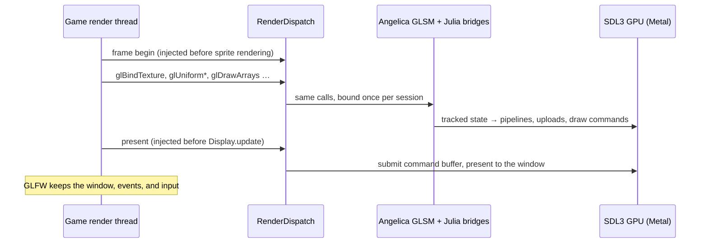

# Julia


Julia is a Project Zomboid (Build 42) client mod that takes the game's OpenGL renderer and runs it on native graphics
APIs. It relies on [Angelica](https://github.com/GTNewHorizons/Angelica)'s GL state manager (GLSM) and its SDL3 GPU
backend.

Game code and mods keep calling plain LWJGL OpenGL. Julia rewrites those calls as classes load, so frames are drawn
with **Metal** on macOS and, later, **Direct3D 12** on Windows and **Vulkan** on Linux. No OpenGL driver is involved.

## How it works

### Startup: all or nothing


Julia never activates a partially supported plan. Unsupported calls, ambiguous frame anchors, or native types crossing
the isolation boundary block startup before live transformations are installed.

### Every frame



- **Isolation.** The game ships its own LWJGL. Julia's graphics stack lives in a separate class loader, and only JDK
  types cross into it. Calls are `invokedynamic` sites bound to the current render session, so no game class ever links
  against Julia's LWJGL.
- **Shaders.** The game's GLSL is compiled by Angelica to SPIR-V and translated to the native shading language.
- **Window.** The game keeps its GLFW window. Julia receives the native handle (Cocoa, Win32, X11 or Wayland), wraps it
  in an SDL window, and puts back the window state it changed when it detaches.
- **Failure.** An exception inside a frame aborts the GPU frame before it propagates, so nothing half-recorded is ever
  presented.

## Status

Julia is experimental and currently targets macOS. Local PZ Build 42 testing has confirmed Metal rendering of menu
videos, map tiles, character previews, world textures, wall cutaways, and the character Info tab. The same dense forest
that previously fell to about 10 FPS now holds 60 FPS in the tester's scene after eliminating repeated index-buffer
readbacks. This is a local result, not a general performance guarantee.

The automated baseline passes 175 JVM tests plus the windowless Metal suite. Checks cover shader linking, uniform
defaults/reflection, streamed indices, texture views, stencil sampling, depth, viewport clipping, video uploads, initial
presentation, ImGui, array resource APIs, multiple draw buffers, native buffer textures, named texture storage/uploads, instanced vertex bindings, and real Metal timer queries. Timer checks verify pending/completed results, elapsed queries,
query reuse, and that CPU sleeps are excluded from measured GPU time. Buffer-texture checks verify 2,560 pixels
plus compute results across R/RG/RGBA 32-bit float, signed, and unsigned formats, with shared updates, ranges,
storage replacement, pending draws, deletion, sampler reflection, and a million-texel view. Instancing checks verify
1,248 pixels across shared bindings, per-vertex and per-instance fetches, full-width unsigned divisors, indexed draws,
pipeline reuse, VAO switching, and legacy attribute rebinding. Named-texture checks verify 377 pixels across 2D,
array and volume storage, mip levels, integer/float/half-float transfers, padded pixel layouts, byte swapping, and
draw/upload ordering while preserving texture-unit bindings. These checks do not replace in-game validation.

The installed PZ and ZombieBuddy archives prepare together with zero blockers; a separate JVM smoke test initializes
both agents. A Steam launch with both agents reaches the menu and loads a save in local testing. The approval UI's
separate frame-loop adapter and ViewPoint's setup window are visually confirmed. Host update callbacks draw before
Metal presentation, and ImGui uses the logical target size before final Retina scaling. The latest Steam retry
passes ViewPoint buffer-texture and vertex-binding initialization, then halts during save loading at `glCreateTextures`.
Named-texture creation, parameters, immutable storage and uploads now pass offscreen checks; this implementation
has not yet been retried in Steam.
ZombieBuddy's standalone native-GL approval executable is outside game preparation and remains rejected if loaded
into the game JVM.

Limits include named textures restricted to 2D, 2D arrays and 3D targets, explicitly supported sized storage formats
and matching client transfer formats (plus RGB8 promotion and BGRA8 conversion), rejected client uploads with pixel-unpack
buffers bound, rejected nonzero named texture base levels and unsupported wrap modes (including clamp-to-border), vertex-write compute replay rejecting divisors above 65,535 (ordinary native vertex fetch retains
all 32 unsigned bits), buffer textures restricted to the nine R/RG/RGBA 32-bit formats (no sampler arrays or image load/store),
full-image same-format 2D texture views, a costly stencil-extraction fallback, rejected compute sampling
of stencil views, and rejected linked-stage regeneration with shader storage blocks. Unplanned or changed graphics
consumers are refused at load time. ZombieBuddy owns mod approval. Julia prepares approved JARs before classpath
publication and patch execution, translating supported graphics operations and replacing unsupported operations with
fatal diagnostics at the call site. Unused unsupported branches do not stop a mod from loading. Unknown integer
and floating-point backend state queries throw instead of returning invented zero limits.
In a live agent session, any translation, backend, frame, or graphics-preparation failure writes and flushes
`fatal-error.txt` in that run's directory, then immediately halts Java with exit code 70. Mod exception handlers,
cleanup, and shutdown hooks cannot continue with a broken renderer. Standalone library tests and offscreen probes
do not arm this live-process policy. Preparation diagnostics are written under `~/Zomboid/julia/run-*/mod-<sha256>.txt`; failures to prepare translation are fatal.
This does not establish ViewPoint rendering support. The Lua-only menu status is user-confirmed in Steam;
ASCII separators avoid missing glyphs.

## Building

The repository root is the mod folder (`common/`, `42/mod.info`). The Gradle build lives in `java/`. You need
JDK 25, and the build works on macOS and Linux only. macOS builds also require CMake 3.24+ and the Xcode
command-line toolchain. The first build downloads a SHA-256-pinned SDL 3.4.12 source archive and builds Julia's
Metal timestamp and buffer-texture extensions; later builds reuse the native build directory. Linux retains the upstream SDL binary;
its native timer provider and game-window integration are not implemented yet.

```sh
cd java
./gradlew check                    # tests; never launches the game or opens a window
./gradlew :agent:jar               # → modules/agent/build/libs/julia-agent.jar
./gradlew :zomboid-mod:modZip      # → modules/zomboid-mod/build/distributions/Julia.zip (Lua status companion)
```

The repository folder is the Lua status companion. Copy it into the PZ `mods` directory as `Julia`, or extract the ZIP.
The agent is installed separately; building never modifies the live game.

These native probes run only when requested and open no window:

```sh
./gradlew :probe:renderProbe       # raw Metal device: clear + translated textured draw
./gradlew :probe:adapterProbe      # full GLSM adapter on redirected OpenGL calls
./gradlew :probe:suiteProbe        # both, in the same order as the mod
./gradlew :probe:installDist       # standalone probe CLI; does not install the mod
JAVA_OPTS="-XstartOnFirstThread --enable-native-access=ALL-UNNAMED" \
  modules/probe/build/install/probe/bin/probe --imgui-adapter /tmp/imgui-probe /path/to/game.jar /path/to/natives
```

These offline audits read JAR bytecode and never load game classes:

```sh
./gradlew :probe:installDist
modules/probe/build/install/probe/bin/probe --prepare-runtime preparation.tsv projectzomboid.jar
modules/probe/build/install/probe/bin/probe --audit-redirects --compat redirects.tsv projectzomboid.jar
```

Logging defaults to `error`. Set `LOG_LEVEL=warn|info|debug` to see more.

## In the game

Copy the built `java/modules/agent/build/libs/julia-agent.jar` into the game's Java directory.
On macOS this is `Project Zomboid.app/Contents/Java`. With ZombieBuddy installed, use these Steam launch options:

```text
-XstartOnFirstThread -javaagent:julia-agent.jar=activate -javaagent:ZombieBuddy.jar --
```

ZombieBuddy is optional: omit its `-javaagent` option when it is not installed. When using both agents, Julia must
register first. Keep the final `--`, required by the macOS
launcher. Julia activates before the in-game mod list is available: disabling its mod-list entry does not disable the
agent. Remove its `-javaagent` option to return to vanilla rendering. ZombieBuddy approvals remain in force.

The optional Lua-only Julia mod shows live renderer status at the bottom left of the main menu, such as
`Julia active | Metal`, or `Julia inactive` when the renderer is absent. It requires no ZombieBuddy approval or Java JAR.
Enable this companion in the mod manager to show it. It does not activate the agent itself.

`activate` creates a fresh directory under `~/Zomboid/julia/run-*/` on every launch. For a controlled test,
`activate=/absolute/path/new-run` selects an explicit fresh report directory. Logs default to `error`; `LOG_LEVEL`
enables more detail. Keep test saves separate until the desired mod combination has been validated.

Diagnostic Java entry points remain in the development modules; they are not included in the Lua companion ZIP.

## License

Julia's own code is [WTFNMFPL](LICENSE). The bundled Angelica, LWJGL3ify, and RetroFuturaBootstrap libraries are LGPL v3.
See [THIRD_PARTY.md](THIRD_PARTY.md).

> [!NOTE]
> This project contains AI-generated code. See [AI_USAGE.md](AI_USAGE.md) for details.

### Controlled startup tests

Use `-javaagent:/absolute/path/julia-agent.jar=activate=/absolute/path/new-report-directory` with a separate game
profile. Unsupported in-process consumers block startup; activation does not automatically fall back to vanilla.
