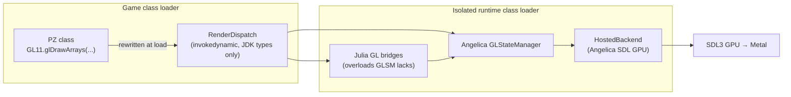
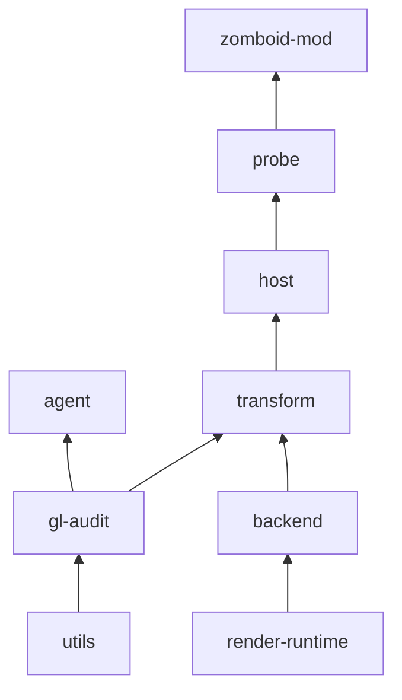

# Julia

Julia is a Project Zomboid (Build 42) client mod. It runs the game's OpenGL rendering through
[Angelica](https://github.com/GTNewHorizons/Angelica)'s GL state manager (GLSM) and its SDL3 GPU backend, so the
game can draw with native graphics APIs instead of the platform's OpenGL driver.

**Metal on macOS comes first.** Direct3D 12 / Vulkan on Windows and Linux are planned; the platform seams already exist.

> **Status: integration stage.** Julia does not replace the game renderer yet. The mod currently runs
> self-verifying probes inside the game process: a Metal device baseline, the full GLSM adapter on redirected
> OpenGL calls, and an experimental presentation into the game window. All of them check their output
> pixel-by-pixel and restore the game's GL state afterwards.

## How it works

Game classes keep calling ordinary LWJGL OpenGL. Julia rewrites those call sites as the classes load. Each call
then reaches Angelica inside an **isolated runtime**: a separate class loader with its own LWJGL 3.4, SDL3, and
Angelica. Nothing native is shared with the game's LWJGL.



The bytecode pipeline for a game class:

1. **Upstream redirect.** Angelica's `GLSMRedirector` points LWJGL GL calls at `GLStateManager`.
2. **Bridge passes.** Julia adds the routes GLSM can't handle on its own: capability reads, vanilla aliases, uniform overloads and queries, resource writes, and storage-only texture allocation.
3. **Typed dispatch.** Every call into the runtime becomes `invokedynamic` through `RenderDispatch`. Only JDK types cross the loader boundary. Calls bind per render session, and a class that would leave any native GL call behind is refused before it can run.
4. **Frame hooks.** These bracket PZ's render step (`SpriteRenderer.postRender` → `Display.update`) with begin, present, and abort.

**Windowing.** The game keeps its GLFW window, event loop, and input. Julia passes the window's native handle across as a
`ForeignWindow` (Cocoa, Win32, X11 or Wayland). The runtime wraps it in an SDL window through a platform
`BorrowedWindow` and restores the native window state on close.

## Modules



| Module | Role |
| --- | --- |
| `utils` | JDK-only helpers: class-archive walking, SHA-256, TSV, `LOG_LEVEL` logging setup |
| `gl-audit` | Offline inventory of graphics calls in JARs (`gl-audit` CLI) |
| `agent` | `-javaagent` that records graphics references of loaded game classes without changing them |
| `render-runtime` | JDK-only boundary shared by every loader: `RenderSession`, `RenderDispatch`, frame hooks, `ForeignWindow` |
| `backend` | Runs inside the isolated runtime: hosted SDL backend, GL bridges, `Platform`, window borrowing (`window.macos`) |
| `transform` | Bytecode passes, the endpoint registry, runtime preparation, and offline redirect/preparation audits |
| `host` | Creates the isolated runtime: an adapting class loader plus a typed dispatch session |
| `probe` | Native self-checking scenes and the `probe` CLI |
| `zomboid-mod` | ZombieBuddy entry point. It schedules probes on PZ's render thread and restores host GL state |

## Building

You need JDK 25. Gradle pins its daemon to Java 25 and verifies the wrapper checksum. Unix only.

```sh
./gradlew check                    # unit tests; never launches the game or opens a window
./gradlew :zomboid-mod:modZip      # → modules/zomboid-mod/build/distributions/Julia.zip
```

Native probes run only when you invoke them, and they open no window. Results land under `modules/probe/build/reports/`:

```sh
./gradlew :probe:renderProbe       # raw Metal device: clear + translated textured draw
./gradlew :probe:adapterProbe      # full GLSM adapter on redirected OpenGL calls
./gradlew :probe:suiteProbe        # both, as the mod runs them
```

Offline audits read JAR bytecode without loading any game classes:

```sh
./gradlew :probe:installDist
modules/probe/build/install/probe/bin/probe --audit-redirects --compat redirects.tsv projectzomboid.jar
modules/probe/build/install/probe/bin/probe --prepare-runtime preparation.tsv projectzomboid.jar
```

Logging defaults to `error`. Set `LOG_LEVEL=warn|info|debug` to see more.

## Running in the game

The mod needs the ZombieBuddy mod to load its Java code.
Approve `Julia.jar` when ZombieBuddy asks. Results go to `<PZ cache>/julia/run-<pid>/`.

| JVM property | Effect |
| --- | --- |
| `-Djulia.probe=window` | Experimental: present three Metal frames into the game window (default `adapter`, offscreen) |
| `-Djulia.outputDir=…`, `-Djulia.modJar=…` | Override the output root and archive location for isolated test launches |

## Platforms

| | GPU driver | Status |
| --- | --- | --- |
| macOS | Metal | Device and adapter probes verified in-game; window presentation experimental |
| Windows | Direct3D 12 | Planned: `ForeignWindow.Win32` and `Platform.WINDOWS` declared, not implemented |
| Linux | Vulkan | Planned: X11/Wayland declared, not implemented |

## License

Third-party notices are in [THIRD_PARTY.md](THIRD_PARTY.md). Angelica, LWJGL3ify, and RetroFuturaBootstrap are LGPL v3.
