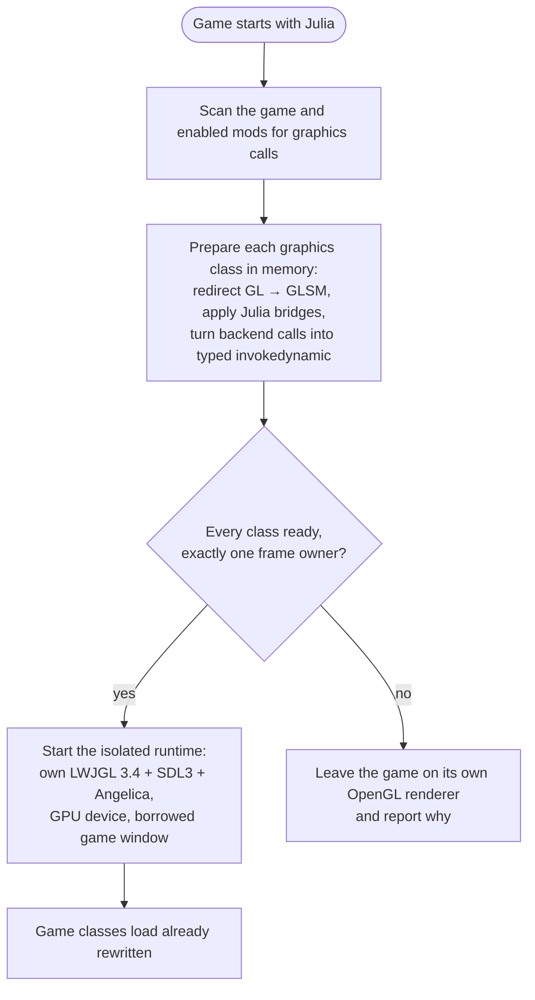
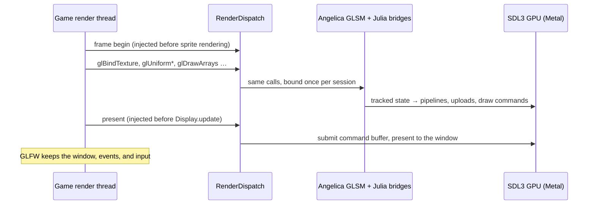

# Julia


Julia is a Project Zomboid (Build 42) client mod that takes the game's OpenGL renderer and runs it on native graphics
APIs. It relies on [Angelica](https://github.com/GTNewHorizons/Angelica)'s GL state manager (GLSM) and its SDL3 GPU
backend.

Game code and mods keep calling plain LWJGL OpenGL. Julia rewrites those calls as classes load, so frames are drawn
with **Metal** on macOS and, later, **Direct3D 12** on Windows and **Vulkan** on Linux. No OpenGL driver is involved.

## How it works

### Startup: all or nothing



Julia never rewrites part of the game. A single unsupported call, an ambiguous frame anchor, or a class that would
pass native types across the boundary keeps the whole game on vanilla OpenGL. You get a report instead of a broken
frame.

### Every frame



- **Isolation.** The game ships its own LWJGL. Julia's graphics stack lives in a separate class loader, and only JDK
  types cross into it. Calls are `invokedynamic` sites bound to the current render session, so no game class ever links
  against Julia's LWJGL.
- **Shaders.** The game's GLSL is compiled by Angelica to SPIR-V and translated to the native shading language.
- **Window.** The game keeps its GLFW window. Julia receives the native handle (Cocoa, Win32, X11 or Wayland), wraps it
  in an SDL window, and puts back the window state it changed when it detaches.
- **Failure.** An exception inside a frame aborts the GPU frame before it propagates, so nothing half-recorded is ever
  presented.

## Status

Julia is in its integration stage. An **experimental startup agent** redirects vanilla rendering to Metal; the normal
ZombieBuddy mod entry still runs probes. The startup path is not ready for gameplay. What works today:

- Inside the running game, the mod runs self-verifying probes on PZ's render thread: a Metal device baseline, the full
  GLSM adapter drawing through redirected OpenGL calls, and an experimental presentation into the game window. Each
  probe checks its output pixel by pixel and then restores the game's GL state.
- Offline preparation of vanilla reports 182/182 graphics consumers structurally ready and
  zero static blockers. Structural readiness does not establish rendering correctness; startup activation is explicit.
- Debug callbacks now cross the isolated runtime through a typed Java method handle. Windowless checks verify SDL
  validation-relay delivery, UTF-8 messages, full-width user pointers, replacement, unregistration and shutdown cleanup.
  Messages are injected into the relay for this check; actual driver diagnostics depend on validation being enabled.
  Only the observed direct GL43/KHR registration form is bridged; other callback APIs remain outside this coverage.
- The current offline checks pass 133 JVM tests and verify 40,274 pixels on windowless Metal. The camera-depth fix and stable character-preview background are user-confirmed in PZ.
- ImGui draw handoffs stay on the game side, calling the prepared renderer and then freeing the owned draw data.
  The archive gate requires that renderer to be included and prepared. A separate windowless probe uses the supplied
  archive's actual ImGui JNI and GL renderer: 2,048 pixels verify font-atlas sampling, texture switching, clipping,
  2× framebuffer scale, repeated draws and caller-state restoration. Detached platform viewports and in-game startup
  lifecycle are not covered by this probe.
- GL shader objects compile and link with the bundled glslang desktop frontend, including helper objects without
  `main`. Immutable compile snapshots allow shared helpers and repeated links without sharing mutable native IR.
  Multi-object stages and the observed min/max/clamp overrides regenerate one linked stage for Angelica's Vulkan
  transform; user functions are renamed by SPIR-V function ID so builtin overloads keep their meaning. Ordinary
  single-object translation keeps its existing resource layout and names. Windowless draws verify 256 pixels across
  sharing, attachment order, macro scopes, deferred deletion and relinks. Regenerated stages with SSBOs explicitly
  reject linking until resource-name preservation is implemented. A live retry renders textured characters and reaches
  the world. After preprocessing was corrected, the three previously observed shader compilation failures no longer
  appear in the live retry; visual defects remain.
- Program-resource queries reflect linked SPIR-V storage blocks and buffer variables, recovering original GL bindings
  from Angelica's remapped descriptor tables. Checks cover struct arrays, matrix and array strides, cross-stage blocks,
  runtime arrays, compute read/write bindings, truncated outputs and cache invalidation after relinking. Only the three
  observed query overloads and these two interfaces are bridged. Geometry stages, block instance arrays,
  multidimensional/specialization arrays and nested arrays of structs are explicitly rejected.
- Texture views support the full-image, same-format 2D path used by PZ: names share storage, sampler and aspect state
  stay independent, and deleting a parent preserves surviving views. Shader sampling of the stencil aspect uses a GPU
  extraction fallback, verified for all 256 values and after writes through a view. This correctness-first path records
  256 extraction draws per consumed source texture per draw; it is not a performance-ready implementation. Mip/layer
  subsets, format reinterpretation and compute dispatch with bound stencil-aspect textures are explicitly rejected.
  Julia also replaces GLSM's Minecraft texture-shrinking deletion workaround and loads the bundled backend shaders
  without Minecraft. Native calls zero-extend stencil references to preserve values 128–255 on macOS ARM64.
- The startup agent preflights classpath archives, rejects changed or unplanned graphics consumers, opens its isolated
  backend on the first render-context call, and closes it before the host window is destroyed. Initialization uploads
  survive the first frame boundary. Live vanilla testing reaches the menu through Metal; the host's logical render size
  is scaled to the Retina drawable. Full-size UI, aligned input and animated menu video are user-confirmed. Ranged indexed quads now use the existing quad conversion, with both triangle
  halves verified offscreen for every index width. Invalid matrix uploads return a GL error before touching staging,
  preventing the observed bone-palette overflow from aborting the renderer. The latest live retry renders the world,
  floors and sprites correctly according to the user after restoring uniform defaults. The menu map selector still has missing tiles, the character-preview background is now stable, and character surfaces now render correctly after camera-depth clamping. Capability reads on the game-logic thread now use an immutable
  shared snapshot; only GPU operations enter render-thread dispatch. World entry no longer raises the prior
  capability-thread exception. These results establish partial rendering, not gameplay correctness.
- Video-style CPU texture pointers now upload their pixels instead of being mistaken for PBO offsets. Windowless
  checks cover RGBA, padded RGB, unpack skips and decoder-buffer reuse. Animated menu video is now user-confirmed in PZ.
- Conditional shader branches now resolve through glslang before Angelica builds its compatibility syntax tree.
  Legacy sampler identifiers use its existing `texture` → `gtexture` lookup alias before texture-call modernization.
  A native regression reproduces the prior missing-return error, then verifies 64 textured pixels and public uniform
  lookup after the fix. The latest live retry has no shader compilation failures, but the map is still black, the
  character-preview background flickers, and floors remain white.
- Link-time uniform initializers now survive Vulkan UBO lowering: compiler-folded OpenGL SPIR-V constants initialize
  the actual program staging without rebinding it. Checks cover 32-bit float/int/uint/bool scalars, vectors, matrices
  and arrays, queries before binding, explicit overrides, relinking and a different current program pending deletion.
  Other initializer types are rejected. This fixes an offscreen reproducer of missing defaults; PZ's chunk shader
  relies on `useTexture = 1`; the live retry now has textured floors and proper world rendering according to the user.
- Camera depth ranges clamp each endpoint to `[0, 1]` before entering GLSM's state cache and the native viewport.
  PZ passes `(-10, 10)` for its model camera; a regression caught both layers retaining those invalid values.
  Offscreen checks now verify near/far depth ordering and independently verify CW/CCW face classification with
  front/back/disabled culling on both texture and default framebuffers. No winding override was introduced; the
  depth-range fix is now user-confirmed to restore the character's outer surfaces.
- Revisiting the ranged-quad fix now covers map-style streamed interleaved position/color/UV buffers, texture
  sampling, matrix uploads, nonzero index offsets and separate tile runs. These now verify 1,024 pixels across texture switches and repeated partial submissions;
  extending the same test to the default framebuffer reproduced disappearing tiles after a GPU index readback. Matrix rejection debug
  messages include the program, uniform name and matrix count to distinguish the guard from a draw-state defect.
- Replacing a GPU command buffer within a frame now preserves the default framebuffer's clear history. Previously,
  quad index readbacks reset `clearedThisFrame`, causing subsequent default-framebuffer draws to clear earlier
  contents. The map-style native regression fails before this change and preserves both tiles afterward. The change
  is pinned to the command-buffer replacement method; normal new-frame clearing is untouched. The live retry restores the preview background and partial map rendering; some map tiles remain missing.
- Every mid-frame command-buffer replacement now invalidates cached vertex/fragment uniform pushes. SDL can recycle
  the same native command-buffer address, which previously made the cache treat a fresh recording as already
  populated. A repeated map-tile draw regression fails before this change and passes afterward. Its effect on the
  remaining live map gaps awaits a retry.
- For a bounded CPU-side draw trace, set `-Djulia.trace.quads=N` (maximum 4,096) with `LOG_LEVEL=info`.
  The trace records ranged-quad draw state, texture handles/metadata, uniform values and available buffer shadows;
  it performs no GPU readbacks and changes no bindings. It is disabled by default. The latest live map still has
  stationary gaps despite the two submission fixes, so further tile-state diagnosis is required.
- Startup transformation excludes trusted shared-runtime classes by code source. Rejected consumers return nonempty
  invalid class bytes: empty arrays were ignored by JVMTI instead of preventing class definition.
- Viewpoint and other mods that use modern OpenGL come after vanilla.

| Platform | GPU API | State |
| --- | --- | --- |
| macOS | Metal | Device and adapter verified in-game; window presentation experimental |
| Windows | Direct3D 12 | Planned; the platform seams exist |
| Linux | Vulkan | Planned; the platform seams exist |

## Building

The repository root is the mod folder (`common/`, `42/mod.info`). The Gradle build lives in `java/`. You need
JDK 25, and the build works on macOS and Linux only.

```sh
cd java
./gradlew check                    # tests; never launches the game or opens a window
./gradlew assemble                 # → ../42/media/java/client/Julia.jar, plus modules/zomboid-mod/build/distributions/Julia.zip
```

After `assemble`, the repository folder is a complete mod. Symlink or copy it into the PZ `mods` directory as `Julia`.

These native probes run only when requested and open no window:

```sh
./gradlew :probe:renderProbe       # raw Metal device: clear + translated textured draw
./gradlew :probe:adapterProbe      # full GLSM adapter on redirected OpenGL calls
./gradlew :probe:suiteProbe        # both, in the same order as the mod
./gradlew :probe:installDist       # standalone probe CLI; does not install the mod
JAVA_OPTS="-XstartOnFirstThread --enable-native-access=ALL-UNNAMED" \
  modules/probe/build/install/probe/bin/probe --imgui-adapter /tmp/imgui-probe /path/to/game.jar /path/to/natives
```

These offline audits read JAR bytecode and never load game classes:

```sh
./gradlew :probe:installDist
modules/probe/build/install/probe/bin/probe --prepare-runtime preparation.tsv projectzomboid.jar
modules/probe/build/install/probe/bin/probe --audit-redirects --compat redirects.tsv projectzomboid.jar
```

Logging defaults to `error`. Set `LOG_LEVEL=warn|info|debug` to see more.

## In the game

Julia needs the ZombieBuddy mod to load its Java code. Approve `Julia.jar` when ZombieBuddy asks. Results are written
to `<PZ cache>/julia/run-<pid>/`.

| JVM property | Effect |
| --- | --- |
| `-Djulia.probe=window` | Experimental: present into the game window (default `adapter`, offscreen) |
| `-Djulia.outputDir=…`, `-Djulia.modJar=…` | Override the output root and archive location for test launches |

## License

Julia's own code is [WTFNMFPL](LICENSE). The bundled Angelica, LWJGL3ify, and RetroFuturaBootstrap libraries are LGPL v3.
See [THIRD_PARTY.md](THIRD_PARTY.md).

> [!NOTE]
> This project contains AI-generated code. See [AI_USAGE.md](AI_USAGE.md) for details.

### Experimental startup test

Build `./gradlew :agent:jar`. Launch the game with
`-javaagent:/absolute/path/julia-agent.jar=activate=/absolute/path/new-report-directory`, using a separate game profile.
The agent keeps its graphics libraries nested and does not add its LWJGL to the game classpath. Test with an explicit
vanilla classpath: the standard launcher may also include separate tools such as ZombieBuddy's native ImGui approval UI,
which appropriately fail whole-input preparation. This experimental path refuses startup when preparation is blocked.
Do not load it alongside the ZombieBuddy probe mod or use an existing save for validation.
